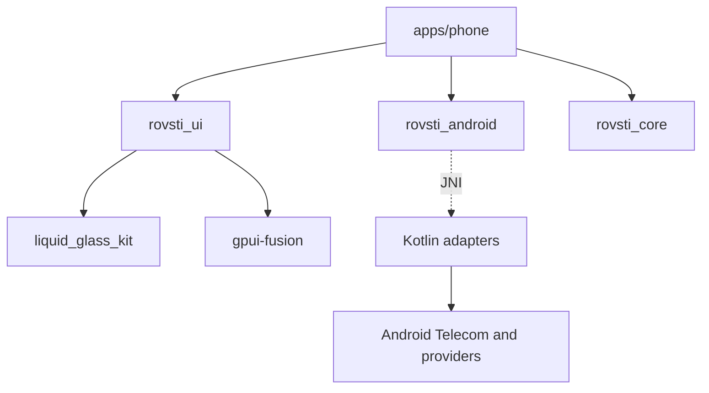
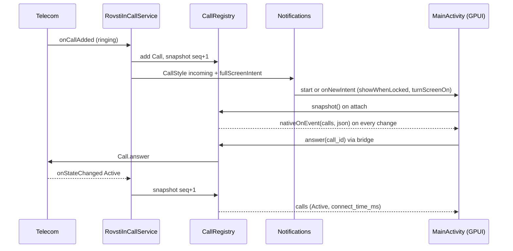

# Architecture Spine: Rovsti Phone

## Design Paradigm

**Android owns system state; Rust renders snapshots and issues commands.** Android system components (InCallService, notifications, providers, roles) are Kotlin adapters. The GPUI app is a pure renderer of immutable snapshots plus a command issuer. Domain logic is platform-free Rust. Layers map to directories:

| Layer | Where | Role |
| --- | --- | --- |
| Domain | `crates/rovsti_core` | Call model and reducer, `CallScene`, audio endpoint list, call-log grouping and frequent contacts, contact search and T9 index, setup checklist logic, settings and backup model with typed schema upgrades, wire DTOs, frame stats. No I/O. |
| Ports | `crates/rovsti_android` | Generic JNI seam: command calls, event channel, provider pulls. `Error::Unsupported` on desktop. App-agnostic. |
| Presentation kit | `crates/rovsti_ui`, `crates/liquid_glass_kit` | Glass, springs, theme, accent, tab bar, perf hooks. |
| App | `apps/phone/src` | Views, view-models, `backend.rs` (the only caller of `rovsti_android`). |
| Android adapters | `crates/rovsti_android/kotlin` (shared), `apps/phone/platforms/android/app/src/main/kotlin/dev/rovsti/phone` (phone) | InCallService, CallRegistry, notifications, providers, activity glue. |

## Invariants & Rules



Allowed edges only: the arrows above. `rovsti_core` depends on nothing but serde and thiserror (`serde_json` is a dev-dependency only; JSON text is parsed outside core, typed values are handed in). `rovsti_ui` may depend on `rovsti_core` (storage). `rovsti_android` depends on neither `rovsti_core` nor `rovsti_ui`. `rovsti_ui` never depends on `rovsti_android`. Kotlin never calls Rust except `nativeInit` and `nativeOnEvent`.

### AD-1 — Single GPUI activity is the in-call and incoming surface (resolves Q1)

- **Binds:** FR-19, FR-22, FR-24, NFR-2, NFR-6
- **Prevents:** a second `GpuiSession` (second wgpu `Application`) and two diverging call UIs.
- **Rule:** `MainActivity` (singleTop, extends `GpuiActivity`) is the only activity. A `setFullScreenIntent` on the incoming CallStyle notification targets it. `setShowWhenLocked(true)` and `setTurnScreenOn(true)` are called dynamically in `onCreate` and `onNewIntent` only while `CallRegistry` has a live call, and reset to false when the last call is removed. They are never set in the manifest. When a call surface ends, `moveTaskToBack(true)` keeps the GPUI session warm; `finish()` is not used for it. Evidence: `GpuiSession` is one `Application` per Activity, created at first Surface (hosting.md, `bridge.rs` `create`); additional windows are unsupported. A native Kotlin curtain over the `SurfaceView` (same activity, removed on first GPUI frame) is the pre-approved contingency only if spike S2 misses NFR-2. One Kotlin function `CallSurface.raise()`, owned by `RovstiInCallService`, is the only way the activity is brought up for a call: incoming (full-screen intent), after Answer (activity PendingIntent, not a broadcast trampoline, which Android 12+ blocks), and outgoing calls placed by any source (other apps, Bluetooth, Assistant). Back inside the app calls `moveTaskToBack(true)` (edit in the owned host `GpuiActivity.onBackPressed`), never `finish()`, so the session stays warm. Spike S2 must prove all five raise paths, locked and unlocked.

### AD-2 — Answerability never depends on GPUI

- **Binds:** FR-21, FR-23, FR-24, NFR-2, NFR-6, SM-2
- **Prevents:** a missed or unanswerable call because wgpu was still initialising or the view crashed.
- **Rule:** For every incoming Call, Kotlin posts one `Notification.CallStyle.forIncomingCall` (`Person` with the caller name; argument order is `(person, declineIntent, answerIntent)`; Decline goes to `CallActionReceiver` (registry-only, no activity start), Answer is an activity PendingIntent to `MainActivity` with extra `answer_call_id`) with the full-screen intent from AD-1. Ongoing calls post `CallStyle.forOngoingCall` with End. Notification actions call `CallRegistry` directly and never require Rust. The caller display name is resolved once in Kotlin (`ContactsQuery.lookup`) and carried in the snapshot as `display_name` (nullable); Rust never re-resolves it for calls. If `canUseFullScreenIntent()` is false, the heads-up notification with Answer/Decline is the committed fallback and the FR-5 Setup item is mandatory. Ringtone and vibration stay with Telecom (`IN_CALL_SERVICE_RINGING` is not set). **Amended 2026-10-28 (AD-28):** the incoming notification may carry a third action "Message" (an activity PendingIntent to `MainActivity` with extra `reply_sheet_call_id`; never a broadcast), present only when the Kotlin settings mirror (AD-30) holds at least one quick reply; Answer and Decline stay registry-only.

### AD-3 — Lock-screen call-only mode

- **Binds:** FR-22, FR-24, privacy
- **Prevents:** contacts, call log or tabs visible over the lock screen.
- **Rule:** Every snapshot carries `keyguard_locked`. When `keyguard_locked && calls non-empty`, the app renders only the Incoming or In-Call screen: no Tab Bar, no navigation, no Contact Sheet. `keyguard_locked` is derived in Kotlin from `KeyguardManager.isKeyguardLocked`, refreshed by `addKeyguardLockedStateListener` where available, else `ACTION_USER_PRESENT`/`ACTION_SCREEN_OFF` receivers registered only while a call exists, and on `onResume`; a missing value counts as locked. When locked with no calls remaining, the app renders a blank backdrop and calls `moveTaskToBack(true)` after the Call-ended hold; tabs never render over a locked keyguard. **Amended 2026-10-28:** the `addKeyguardLockedStateListener` path is not used (it needs `SUBSCRIBE_TO_KEYGUARD_LOCKED_STATE`, API 33); lock state comes from the receivers and `onResume` only, and the blank-backdrop and `moveTaskToBack` rule fires only on a transition from locked-with-calls to no calls, never on the default-locked first snapshot. A re-lock closes Settings, Details and picker sheets. **Amended 2026-10-28 (AD-24):** call-only mode also covers v0.2 surfaces. While `keyguard_locked`, Settings, Call details, the Contact Sheet and the Add call sheet's Favorites/Contacts segments do not open; Add call first calls `KeyguardManager.requestDismissKeyguard(activity, callback)` (Kotlin, API 26) and opens the sheet only from a success callback; the reply sheet, route popover, Waiting card and merge/swap controls are call surfaces and stay available.

### AD-4 — Kotlin `CallRegistry` owns call state; Rust attaches by snapshot (resolves Q3)

- **Binds:** FR-13..FR-20, FR-24, NFR-3, NFR-6
- **Prevents:** two owners of call state, lost state on GPUI restart, UI that disagrees with Telecom.
- **Rule:** `CallRegistry` (Kotlin singleton, process lifetime) is fed only by `RovstiInCallService` callbacks (`onCallAdded/Removed`, `Call.Callback`, audio state or `CallEndpoint`). It assigns a stable `call_id` (Int, never reused in a process). On GPUI attach, `main()` calls `calls::snapshot()` once, then consumes pushes. `rovsti_core::call::CallModel` stores the last snapshot; it never infers state from commands. A command is optimistic in the UI only for press feedback; displayed Mute, Route and Hold always come from the next snapshot (target under 500 ms). All registry mutation and snapshot building (incl. `seq`) happen on the main Looper; no lock is held across a binder call; `onUnbind` clears the registry and pushes an empty snapshot. Snapshot fields: `v, seq, now_ms, keyguard_locked, audio{muted,route,routes[]}, foreground_call_id, waiting_call_id, calls[]{id,state,number_raw,normalized,display_name?,connect_time_ms,can_hold,is_incoming,disconnect_cause?}`. Audio uses `CallEndpoint` (minSdk 34) with one fallback, see AD-23. **Amended 2026-10-28:** the snapshot fields above are extended additively by AD-23 (`audio.endpoints`), AD-24 (`background_call_id`, `can_add_call`, `can_merge`, `can_swap`, per-call `parent_id`, `children`, `caps`, `props`, `account_key`) and AD-29 (`ringer_silenced`); the foreground/background/waiting selection rule is AD-24's. `v` stays 1. Kotlin maps the call state (`Call.Details.getState()`, API 31; `Call.getState()` is deprecated there) to `dialing|ringing|active|holding|disconnected` as built and extended: `NEW, CONNECTING, DIALING, PULLING_CALL, SELECT_PHONE_ACCOUNT, AUDIO_PROCESSING` -> `dialing` (`SELECT_PHONE_ACCOUNT` also sets `selecting_account`), `RINGING` and `SIMULATED_RINGING` (silent ring or Do Not Disturb) -> `ringing`, `DISCONNECTING` and `DISCONNECTED` -> `disconnected`; Kotlin picks foreground/waiting ids; Rust validates, never re-selects. `answerReplacing` is a registry-owned pending operation that answers on the matching `onCallRemoved`, timeout 2 s.

### AD-5 — Event transport: whole-state JSON snapshots over one native method (resolves Q2)

- **Binds:** FR-13..FR-20, FR-29, NFR-3, NFR-7
- **Prevents:** per-event typed JNI signatures drifting between Kotlin and Rust, and delta/ordering bugs.
- **Rule:** Kotlin to Rust is exactly `RovstiBridge.nativeOnEvent(kind: String, json: String)` implemented in `rovsti_android::events`. It pushes into a process-static `Mutex<Option<UnboundedSender<RawEvent>>>`; it never touches GPUI types. `main()` installs a fresh channel on each session (replacing the old sink) and drains it in a GPUI foreground task. Kinds: `calls` (full `CallSnapshot`), `call_log_changed`, `contacts_changed`, `permissions_changed`. A snapshot carries a monotonic `seq`; the reducer ignores any `seq` lower than the one held. Events with no sink are dropped; attach re-pulls. Rust to Kotlin stays static methods taking String, Int, Boolean. Kotlin never calls `nativeOnEvent` directly: the only caller is `RovstiBridge.emit(kind, json)`, a no-op until `attachNative()` has run, catching `LinkageError`, so a registry mutation never throws out of a Telecom callback. Attach order in `main()`: install the new channel sink, then push `snapshot()` through it, then re-pull providers; the sink is cleared on session close. `permissions_changed` is emitted only from `MainActivity.onResume`.

### AD-6 — Commands are idempotent and id-addressed

- **Binds:** FR-14..FR-18, FR-20, FR-24, NFR-3
- **Prevents:** acting on the wrong or an already ended call.
- **Rule:** Every call command (`answer`, `reject`, `disconnect`, `hold(on)`, `mute(on)`, `route(name)`, `dtmf(char)`) takes `call_id` where relevant and returns Boolean. Unknown or stale ids are no-ops returning false. Waiting-call answer is one Kotlin method `answerReplacing(call_id)` that disconnects the active call first (FR-20), not two Rust calls. **Amended 2026-10-28 (AD-25):** the command set grows by `swap()`, `merge()`, `split(child_id)`, `answerHolding(call_id)`, `rejectWithMessage(call_id, text)`, `silenceRinger()` and `routeEndpoint(id)`; the same rules hold (non-blocking, Boolean, stale no-op). `answerReplacing` becomes one case of the registry's single pending-operation machine (AD-25).

### AD-7 — Elapsed time derives from wall clock, not ticks

- **Binds:** FR-13, NFR-5
- **Prevents:** timers that drift, restart, or force per-second JNI.
- **Rule:** The snapshot carries `connect_time_ms` (`Call.Details.getConnectTimeMillis`). `rovsti_core::call::format_elapsed(now_ms, connect_time_ms)` renders `m:ss` or `h:mm:ss`. The only per-second work during a call is repainting the timer text element.

### AD-8 — Native library is loaded by the activity, never by `Application`

- **Binds:** NFR-2, FR-1
- **Prevents:** loading the wgpu-sized `.so` on every InCallService cold bind.
- **Rule:** `RovstiPhoneApp.onCreate` initialises Kotlin-only pieces (channels, `CallRegistry`, `RovstiBridge.install(app)` without `System.loadLibrary`). `MainActivity.onCreate` calls `RovstiBridge.attachNative()` (which runs `nativeInit`) after `super.onCreate`, because `GpuiActivity` loads the library there. This replaces the load in the current `RovstiBridge.install`. `rovsti_android` must compile `BRIDGE.set` as idempotent across sessions.

### AD-9 — Provider data is pulled as JSON off the UI thread

- **Binds:** FR-26..FR-35, NFR-4
- **Prevents:** UI-thread provider queries and per-row JNI chatter.
- **Rule:** `providers::{call_log(limit), contacts(), favorites()}` return one JSON string per call and run on a GPUI background-executor thread (`with_bridge` attaches any thread). Kotlin keeps one `ContentObserver` each for `CallLog.Calls` and `ContactsContract`; they only emit `call_log_changed` / `contacts_changed`, debounced 300 ms. `setStarred(contact_id, bool)` is the only provider write besides `markMissedCallsRead()`. **Amended 2026-10-28 (AD-31):** the provider writes are exactly the list in AD-31 (blocked numbers, call-log delete/restore, contact delete, contact ringtone, plus the two above); each returns an envelope string, not a Boolean, and runs off the UI thread. The Recents pull excludes blocked rows (AD-27) and carries `account_key` (AD-26); quality `features` are pulled only for Call details (AD-31), not for the 500 Recents rows. Rust builds the in-memory index once per payload and swaps it atomically (Arc swap) into the view; scroll position is preserved.

### AD-10 — Wire DTOs live in `rovsti_core::wire`, versioned

- **Binds:** FR-13, FR-26, FR-30, NFR-8
- **Prevents:** Kotlin/Rust field drift and untestable parsing.
- **Rule:** All JSON shapes are serde structs in `rovsti_core::wire` ignoring unknown fields (forward compatible) with a `v: 1` field, snake_case only, `#[serde(other)] Unknown` on every enum with a safe render (an unknown state never drops a snapshot), `connect_time_ms == 0` meaning not connected, `normalized` = digits with optional leading `+`. Provider pulls return `{v, ok, error?, data?}` and never throw; a `SecurityException` is `ok:false,error:"permission"`. Kotlin builds them with `org.json.JSONObject` (no new dependency). Every DTO has a golden-JSON unit test whose fixture in `crates/rovsti_core/tests/fixtures/` is also read by a Kotlin JVM unit test. `rovsti_android` moves strings only. **Amended 2026-10-28:** additive changes (new optional fields, new enum values with a safe `Unknown`) do not bump `v`, because Kotlin and Rust ship in one APK; a field whose meaning changes or is removed bumps `v` and both parsers reject a higher `v` they do not know by rendering the last good snapshot. Capability sets travel as a documented bitmask (`caps`, `props`) whose bit positions live as constants in `rovsti_core::wire` and `WireJson.kt` and are covered by the golden fixtures. Settings and backup JSON are not wire DTOs; they follow AD-30.

### AD-11 — Dial strings stay raw; `PhoneNumber` is for matching only

- **Binds:** FR-9..FR-12
- **Prevents:** rejecting `*#06#`, USSD, `,` `;`, or emergency numbers.
- **Rule:** `telecom::place_call(raw: &str)` passes the typed string to Kotlin unchanged. Only strings with no digit, `*` or `#` are rejected (shake). No Setup Item gates a call. Kotlin handles `STATE_SELECT_PHONE_ACCOUNT` by `phoneAccountSelected(default outgoing or first suggested, false)`. **Amended 2026-10-28 (AD-26):** on a phone with two or more call-capable accounts Rust chooses the account before placing (`place_call(raw, account_key?)`); the Kotlin auto-select above survives only as the safety net AD-26 defines, so a call is never stuck.

### AD-12 — Dial intents are normalised in `MainActivity`

- **Binds:** FR-3
- **Prevents:** `ACTION_DIAL` being silently dropped (GPUI forwards only `ACTION_VIEW` with data).
- **Rule:** `MainActivity.onCreate/onNewIntent` rewrites `ACTION_DIAL` with a `tel:` URI into `ACTION_VIEW` before calling super; the app handles it in `Application::on_open_urls` by switching to Keypad with the number prefilled and placing no call. DIAL without data just opens Keypad.

### AD-13 — Per-app accent through `rovsti_ui::colors` (resolves UX-Q1)

- **Binds:** DESIGN accent, NFR-13
- **Prevents:** the kit's iOS-blue accent leaking in, and signature churn across components.
- **Rule:** `rovsti_ui::theme::set_accent(AccentPair { light, dark, glow })` is called once in `main()` of each app (`#08806E`, `#2DD4B4`, glow `#14C8A8` for Phone). `rovsti_ui::theme::colors(theme)` returns `Theme::colors()` with `accent` replaced. A workspace `clippy.toml` `disallowed-methods` forbids `Theme::colors` everywhere except `rovsti_ui::theme`. `liquid_glass_kit` is not modified.

### AD-14 — Pure logic placement and test floor

- **Binds:** NFR-8, FR-26, FR-31, FR-5..FR-8, FR-13
- **Prevents:** domain logic in views or Kotlin that cannot be unit-tested.
- **Rule:** In `rovsti_core`: `call` (CallModel, reducer, elapsed format, waiting-call selection), `call_log` (entry types, `group`, missed-badge count given last-seen), `search` (`ContactIndex`, Turkish-aware fold, digits match), `setup` (item state derivation from a readable-facts struct, Xiaomi confirmation and version-reset rule), `wire`, `perf` (FrameStats). **Amended 2026-10-28:** adds `audio` (endpoint list ordering, arrival diff), `scene` (`CallScene` from a snapshot), `settings` (Prefs v2, quick replies, speed dial, favorites order, backup DTO and import preview, typed upgrades), `t9` (inside `search`), `frequent` (inside `call_log`), `emergency` (inside `dial`), `names` (name format and sort). Each has table-driven tests incl. the PRD's examples (ays/Ayşe, ozgur/Özgür, 5551112, consecutive-same-type grouping, `*#06#`). Views contain no branching on domain rules beyond rendering a core enum.

### AD-15 — Only `apps/phone/src/backend.rs` calls `rovsti_android`

- **Binds:** FR-38, NFR-7
- **Prevents:** Android calls scattered through views and desktop panics.
- **Rule:** `backend.rs` exposes a small `Backend` struct returning domain types. On `Error::Unsupported` it serves sample data (FR-38). Views take `Arc` snapshots from `Backend`; they never see `Result`.

### AD-16 — Threading

- **Binds:** NFR-3, NFR-4, NFR-6
- **Prevents:** re-entrancy into a borrowed GPUI `App` and ANRs.
- **Rule:** GPUI state mutates only on the main Looper, via `cx.spawn` tasks fed by the AD-5 channel. JNI event callbacks only enqueue. Blocking JNI (provider pulls) runs on `cx.background_executor()`. Call commands are non-blocking Kotlin methods that return after the Telecom call is issued. No Tokio runtime in Phone.

### AD-17 — Failure containment

- **Binds:** NFR-6, SM-2
- **Prevents:** a GPUI failure dropping or hiding a live call.
- **Rule:** If `GpuiSession.setOnError` fires or the view dies while a call exists, the ongoing-call notification (AD-2) remains and End works. `GpuiActivity.onCreate` installs `setOnError` privately, so after eject the owned host `GpuiActivity.kt` is edited to call an overridable `onGpuiError(error)`; `MainActivity` implements it by keeping the call notification and showing the native message only. `CallRegistry` has no dependency on GPUI classes.

### AD-18 — Manifest and permission contract

- **Binds:** FR-1, FR-5, FR-21..FR-25, NFR-1
- **Prevents:** role ineligibility and silent foreground-service crashes on Android 14+.
- **Rule:** Ejected manifest holds: `RovstiInCallService` (`BIND_INCALL_SERVICE`, `IN_CALL_SERVICE_UI=true`, `foregroundServiceType="phoneCall"`, exported), `MainActivity` filters (MAIN/LAUNCHER; `ACTION_DIAL` with and without `tel`; `VIEW` `tel` BROWSABLE), `CallActionReceiver` (not exported), `android:name=".RovstiPhoneApp"`. The service also declares the `android.telecom.InCallService` intent filter and never `IN_CALL_SERVICE_CAR_MODE_UI`. Final permission set: `CALL_PHONE, READ_CALL_LOG, WRITE_CALL_LOG, READ_CONTACTS, WRITE_CONTACTS, READ_PHONE_STATE, POST_NOTIFICATIONS, USE_FULL_SCREEN_INTENT, REQUEST_IGNORE_BATTERY_OPTIMIZATIONS, BLUETOOTH_CONNECT, FOREGROUND_SERVICE, FOREGROUND_SERVICE_PHONE_CALL, WAKE_LOCK`; `MANAGE_OWN_CALLS` and `BLUETOOTH_SCAN` are removed (ROLE_DIALER satisfies phoneCall FGS) and `gpuiforge.json` is updated to match. Notification lock-screen visibility is public for the caller name only (accepted trade-off); `allowBackup=false` stays. `INTERNET` must be absent from the merged manifest (checked by `scripts/check-apk.sh` with `aapt2 dump permissions`, run manually and listed in the final checks). `min_sdk` 34, `target_sdk` 36. **Amended 2026-10-28 (AD-34):** the permission set above gains `VIBRATE`; the manifest gains a `<queries>` block and a disabled `VoicemailReceiver` (AD-34); `SEND_SMS`, `READ_PHONE_NUMBERS`, `MODIFY_PHONE_STATE` and any call-screening role stay absent.

### AD-19 — Ejected host ownership and shared Kotlin source

- **Binds:** NFR-7, NFR-13, FR-39
- **Prevents:** copy-paste drift of `RovstiBridge.kt` between apps and edits to generated files being overwritten.
- **Rule:** Eject once (`gpuiforge platform eject android`) into `apps/phone/platforms/android` and commit it. Shared Kotlin stays only in `crates/rovsti_android/kotlin/dev/rovsti/bridge` and is included by a committed symlink `app/src/main/kotlin/dev/rovsti/bridge`. Phone Kotlin lives in `app/src/main/kotlin/dev/rovsti/phone`. `min_sdk` 34 is set through `variables.min_sdk` in `gpuiforge.json` and mirrored in the two literals of the ejected `app/build.gradle.kts`. Post-eject owned edits: manifest, `MainActivity`, `GpuiActivity` (Back, `onGpuiError`). The eject bakes absolute paths into `app/build.gradle.kts` (`workingDir`, `--manifest-path`); re-run a documented `scripts/fix-eject-paths.sh` if the repo moves.

### AD-20 — Build and signing pipeline

- **Binds:** FR-39, FR-40, SM-3
- **Prevents:** secrets in the repo or logs, and ABI/profile confusion.
- **Rule:** Debug loop: `gpuiforge run android --device <serial>` (arm64-v8a only, dev profile with the workspace `[profile.dev.package."*"] opt-level = 1`). Deliverable debug APK: `gpuiforge build android`; after the eject the artifact is `apps/phone/platforms/android/app/build/outputs/apk/debug/app-debug.apk` (the PRD's `target/gpuiforge/...` path is managed mode only; `gpuiforge info android` prints the truth and `check-apk.sh` reads it). Perf-realistic APK: `gpuiforge build android --abi arm64-v8a --rust-profile release` (debug-signed, debuggable). Signed release: `source ~/.config/rovsti/signing.env; gpuiforge build android --release` with a `signing` object in `gpuiforge.json` (`keystore` `~/.config/rovsti/rovsti-release.jks` absolute, `key-alias` `rovsti`, `store-password-env` `ANDROID_STORE_PASSWORD`, `key-password-env` `ANDROID_KEY_PASSWORD`). Passwords are never printed, logged, or passed as arguments; the keystore and `signing.env` are git-ignored (`*.jks`, `signing.env`). `ANDROID_NDK_HOME` must point at NDK 29.x. Adb path: `~/Android/Sdk/platform-tools`.

### AD-21 — Performance is engineered, never bought with visual cuts

- **Binds:** NFR-5, NFR-12, DESIGN Performance Budget
- **Prevents:** removing glass, refraction, signature moments or motion to hit a frame number.
- **Rule:** The full liquid-glass look and all 16 signature moments ship. A missed target stays a blocker and is never closed by a visual trade. Any shader, blur-pass or glass-merging change must keep `liquid_glass_kit` `shader_validates` and `glass_snapshot` pixel tests passing (pixel-equivalent output). Refractive-surface counts and "flat glass at rest" in DESIGN.md are advisory, not constraints. A missed target is fixed in code, in this order: (1) idle and re-render discipline: stateful springs request frames only while moving; `cached` views for static subtrees checked via `view_cache` hit rate; no `cx.notify()` per tick for non-visual state; (2) allocation discipline: no `String`/`Vec`/`SharedString` creation in per-frame paths (pre-intern, reuse buffers, fixed-size arrays for springs); (3) virtualised lists with fixed row heights (Contacts 58, Recents 58, header 28); photos decoded off-thread to 128 px in a 64-entry LRU; (4) glass pass cost: reuse the renderer's retained backdrop textures and scissored half-resolution blur (`wgpu_renderer::draw_backdrop_blurs` already limits copy and blur to bounds plus 2x radius), skip blur passes when `blur == 0`, merge adjacent same-spec glass (e.g. the 12 keys, the in-call control row) into one backdrop effect with an instance list, add a cheap shader path variant for non-pressed glass, and pre-compile pipelines at startup; (5) kit changes land in `liquid_glass_kit` with `shader_validates` and snapshot tests green. Visual changes exist only for the system reduced-motion setting and the kit's own `supports_backdrop_blur()` fallback. The 60 fps NFR is the floor; targets scale to the panel refresh rate.
- **Targets (measured, not assumed):** p95 frame work inside one display frame (16.6 / 11.1 / 8.3 ms at 60 / 90 / 120 Hz); CPU frame work under 4 ms; under 1% frames over budget and none over 2x during scripted tab switch, scroll, key press and call flows; cold start to first interactive frame under 1.2 s; idle 0 frames; warm incoming under 1.5 s, cold under 3 s.

### AD-22 — Profiling hooks are part of the product

- **Binds:** NFR-5, AD-21
- **Prevents:** performance claims without data.
- **Rule:** `rovsti_ui::perf` enables `Window::set_frame_diagnostics_enabled(true)` in debug and perf builds and each frame pushes `build_time`, `platform_draw_time`, `view_cache` into a fixed ring (`rovsti_core::perf::FrameStats`, no allocation). A scripted scenario list (S-tab, S-scroll-recents, S-keypad, S-incall, S-incoming) logs p50/p95/p99/max and over-budget counts to logcat tag `RovstiPerf` when leaving a scenario. Cross-check GPU/pacing with `adb shell dumpsys SurfaceFlinger --latency` on the `GpuiView` layer (a `SurfaceView` is not covered by HWUI `gfxinfo`). Thermal state (`App::on_thermal_state_change`) is logged with each report, not used to alter visuals. Perf mode is the Cargo feature `perf` on `rovsti_phone`, off in the signed release build. `platform_draw_time` can include surface waits and renderer diagnostics are unavailable on Android, so the 4 ms CPU figure is asserted from `build_time` only and GPU pacing from SurfaceFlinger latency.

### AD-23 — Audio endpoints are an id-addressed list on the wire (resolves PRD Q7, part 1)

- **Binds:** FR-41..FR-43, NFR-3, NFR-14, NFR-16, NFR-18
- **Prevents:** type-only routing picking the wrong one of two Bluetooth devices, Rust and Kotlin disagreeing on the current route, and two snapshots for one route change.
- **Rule:** The snapshot gains `audio.endpoints: [{id, type, name?, selected, hint?}]` with `type` in `earpiece|bluetooth|wired_headset|speaker|unknown`, `id` = `CallEndpoint.getIdentifier().toString()` (ParcelUuid), `hint` = `"hearing_aid"` or absent. `route` and `routes` stay and are derived from it (`route` = type of the selected endpoint, `routes` = distinct types), so v0.1 screens keep working until Epic 14 replaces them. `TYPE_STREAMING` endpoints are not sent. At most one endpoint is `selected`; none means Rust shows `route`. Kotlin sends Telecom's order; display order is Rust's (`rovsti_core::audio::EndpointList`: Bluetooth newest arrival first, wired, Speaker, Phone, with Phone kept as a dimmed placeholder when Android omits it) and the list also yields the added/removed ids for the arrival and loss moments. `name` is sent for bluetooth, wired and unknown; Rust labels earpiece and speaker itself; an empty Bluetooth name renders "Bluetooth device {n}" by ordinal.
  - Command `callRouteEndpoint(id: String): Boolean` resolves `id` in a Kotlin `Map<String, CallEndpoint>` rebuilt on every `onAvailableCallEndpointsChanged`, on the main Looper, and calls `requestCallEndpointChange(endpoint, executor, OutcomeReceiver)`; an unknown id returns false; a `CallEndpointException` forces an immediate rebuild so the UI reverts. Endpoint ids are session handles: never persisted, never compared across a reconnect (the SDK does not promise stability; spike S3). `callRoute(name)` stays only for the Phone/Speaker toggle and resolves the unique earpiece or speaker endpoint.
  - Only `onCallEndpointChanged`, `onAvailableCallEndpointsChanged`, `onMuteStateChanged` and `onCanAddCallChanged` call `scheduleRebuild()` (one posted Runnable, 12 ms window). Everything that feeds `Focus` or caps rebuilds immediately: `onCallAdded`, `onCallRemoved`, `onStateChanged`, `onDetailsChanged`, `onParentChanged`, `onChildrenChanged`, `onConferenceableCallsChanged`, so a merge never shows a transient three-call scene. Every rebuild cancels a pending scheduled one and assigns `seq` when it runs. Coalescing never defers answer, reject, the notification, `knownIds`, `ringingIds` or `incomingNow`. Rust applies every snapshot in `seq` order and renders once per frame (AD-35).
  - Fallback: if no `onAvailableCallEndpointsChanged` arrives within 1.5 s of the first call, or `getCurrentCallEndpoint()` is null, `AudioPath` switches to legacy: `getCallAudioState()` (deprecated in 34, still present) builds synthetic endpoints with ids `legacy:earpiece|speaker|bluetooth|wired_headset` from `supportedRouteMask` and commands use `setAudioRoute(int)`. The picker then shows types without device names (visible degradation, NFR-16).
  - Lost devices: `EndpointList` keeps a ghost entry ("Disconnected") for a vanished endpoint until the popover is next opened. The first snapshot of a session, and a re-attach, seed the baseline: no arrival or loss moment is played for endpoints already present.
  - Hearing aid: Android has no endpoint type for it. Kotlin sets `hint` when `AudioManager.getAvailableCommunicationDevices()` (API 31) holds an `AudioDeviceInfo` of `TYPE_HEARING_AID` (API 28) whose `productName` equals the endpoint name; Rust adds a whole-word check for "hearing" or "aid". Best effort, never required (UX-Q19; S3).
  - Settings' hearing-aid-compatibility value comes from `telecom::hearing_aid_compatible()` (`TelephonyManager.isHearingAidCompatibilitySupported()`, API 23).
  - `BLUETOOTH_CONNECT`: names come from Telecom, not from the app, so the "Show device names" request row is built only if S3 shows names missing without the grant; the permission stays declared.

### AD-24 — Multi-call model: Kotlin selects, Rust renders a `CallScene` (resolves PRD Q7, part 2)

- **Binds:** FR-44..FR-48, FR-52, NFR-14, NFR-18
- **Prevents:** two selection algorithms, a layout that depends on the number of calls, conference participants treated as separate calls, and a private Add call over the lock screen.
- **Rule:** Every Telecom `Call`, conference children included, has a registry id. A wire call gains `parent_id?`, `children: [id]` (empty when the carrier hides participants), `props` and `caps` bitmasks, `account_key?`, `display_name_alt?`, `ringer_silenced?`, `hold_since_ms?` (when the call went to Holding; the Held card shows time on hold), `participant labels` are Rust's ("Participant n" when a child has neither name nor number). Bits (constants in `rovsti_core::wire` and `WireJson.kt`, golden-tested): `caps` hold=1, support_hold=2, merge=4, swap=8, manage=16, split=32 (`CAPABILITY_SEPARATE_FROM_CONFERENCE`), disconnect_participant=64 (`CAPABILITY_DISCONNECT_FROM_CONFERENCE`), respond_via_text=128, mute=256, add_participant=512; `props` conference=1, hd=2 (`PROPERTY_HIGH_DEF_AUDIO`), wifi=4 (`PROPERTY_WIFI`), emergency=8 (`PROPERTY_NETWORK_IDENTIFIED_EMERGENCY_CALL` or a Kotlin emergency match). `can_hold` stays and equals `caps.hold`. The split and disconnect-participant bits are read from the child call's details, where Telecom sets them.
  - Selection (Kotlin `Focus.of`, replacing the v0.1 rule): consider top-level calls only (`parent_id` absent). `foreground` = first Active, else Dialing, else Holding (lowest id), else Ringing, else Disconnected (the call-ended hold, only when no live non-ringing call exists). A Disconnected top-level call alongside a live one is reported as `ended_call_id` (one snapshot carrying `disconnected` and `disconnect_cause`), which Rust shows in the Ended overlay slot for its 1 s hold; it never takes the foreground. While a `PendingOp` runs the previous foreground is kept. `background_call_id` = the other non-ringing, non-disconnected top-level call while a foreground exists (at most one; extras stay in `calls`, unrendered and logged). `waiting_call_id` = the lowest-id Ringing top-level call that is not the foreground. A conference is one top-level call. When the active party hangs up, the held call becomes foreground in `holding`; nothing resumes by itself (FR-45).
  - Kotlin also computes `can_add_call` (`InCallService.canAddCall()`, false for an emergency call or when two non-ringing top-level calls exist), `can_merge` (foreground `caps.merge`, or any top-level call has a non-empty `conferenceableCalls`) and `can_swap` (two non-ringing top-level calls and the held one can resume, or foreground `caps.swap`). Rust gates controls on these bits; `CallScene::disabled_reason` derives the dim reason from the same bits and counts.
  - `rovsti_core::scene::CallScene` is a pure enum built from `CallModel`: `Single{primary}`, `Two{primary, held}`, `Conference{host, participants, held: Option}` (Conference wins when a conference sits beside a held call), plus independent `waiting: Option` and `ended: Option`. `rovsti_core::scene::DisabledReason` is the closed enum for dim reasons, with a fixed precedence (emergency, ringing/pending, carrier, count, capability). `incall.rs` renders fixed slots (primary block, Held card, Waiting overlay, control grid 3x2, chip row, conference panel); a scene change alters opacity, scale and content, never geometry. The participant list is virtualised with 58 px rows; child ids missing from `calls` are skipped and counted ("n people" when the count is known and no rows exist).
  - Lock screen: while `keyguard_locked` (re-read from `KeyguardManager` at the tap, not the last snapshot), Add call first runs `KeyguardManager.requestDismissKeyguard(activity, callback)` and opens its sheet only from the success callback; see the AD-3 amendment.
  - Timers: each call keeps its own `connect_time_ms`; a conference shows the host's. Per-second repaint stays one element per visible timer (AD-7).

### AD-25 — Multi-call operations go through one pending-operation machine

- **Binds:** FR-44..FR-48, NFR-3, NFR-16
- **Prevents:** races between hold, unhold, answer and merge, a swap that leaves both calls held, and a control stuck in its pending look.
- **Rule:** `CallRegistry` holds at most one `PendingOp` (`AnswerReplacing(target, replaced)` as built, `Swap(toResume)`, `Merge`). Each op has its own deadline (answer 2 s, swap 1 s then one `hold()` retry, merge 2 s) and ends through `finish(op, Done|Failed)`: `Done` on the matching change in `onStateChanged`, `onCallRemoved` or `onChildrenChanged`; `Failed` on the deadline, which never answers a ringing call unless the op is `AnswerReplacing` (its deadline answers the target as built). A new op is refused (false) while another runs, except that `AnswerReplacing` supersedes `Swap` or `Merge`. The wire carries `pending: "answer"|"swap"|"merge"` (optional); Rust shows the pending look exactly while the latest snapshot carries `pending`, with no timer of its own; a failed op sets `pending_failed: <op>` in the next snapshot for one rebuild so the Notice pill can speak.
  - `swap()`: foreground `caps.swap` -> `swapConference()`; otherwise `unhold()` on the held call (Telecom is expected to hold the active call itself; S4). If the former active call is still Active after 1 s the registry calls its `hold()` once, then reports failure.
  - `merge()`: foreground `caps.merge` -> `mergeConference()`; otherwise `foreground.conference(other)` with `other` taken from `conferenceableCalls`. Success is a top-level call with `props.conference` within 2 s, else the timeout clears the op ("Couldn't merge calls").
  - `split(child_id)` is `splitFromConference()` and only when the child has `caps.split`; `disconnect(child_id)` ends one participant; End on a conference is `disconnect(host_id)`.
  - Waiting choices (FR-48): `answerHolding(id)` is `answer(id)` and is offered only when the current call has `caps.hold` and no held call exists (Telecom's hold-for-new-call logic disconnects an unholdable active call, and can disconnect an existing held call; with an Active, a Held and a Ringing call the choice is relabelled "End held call and answer" and S4 records it); `answerReplacing(id)` is the built End-and-answer; Decline is `reject(id)`; Decline-with-message is AD-28. The Waiting card is derived from `waiting_call_id` plus the foreground caps, with no Rust-side inference.
  - Add call has no command: Rust opens the sheet and places through `place_call` (AD-11, AD-26); the network holds the first call; a failed placement leaves it Active. `dtmf` keeps targeting `foreground`. `OngoingCall.of` follows `foreground` and `endAll()` ends every non-ringing top-level call.

### AD-26 — Dual SIM: Rust chooses the account, keys equal the call log's

- **Binds:** FR-11, FR-50, FR-51, FR-67, NFR-14, NFR-16
- **Prevents:** a call stuck in SELECT_PHONE_ACCOUNT, SIM chips that cannot be matched to log rows, and any visible change on a one-SIM phone.
- **Rule:** `account_key = "{ComponentName.flattenToString()}#{handle.id}"`. Log rows build the same string from `PHONE_ACCOUNT_COMPONENT_NAME` and `PHONE_ACCOUNT_ID`, the pair CallLog stores. Rust treats it as opaque.
  - `telecom::phone_accounts()` returns `{v,ok,data:{accounts:[{key,label,slot_index?,color_argb,sim,enabled}],default_key?,ask}}` (`color_argb` Int with 0 = none, `slot_index` 0-based; a `rovsti_core::wire` struct with a golden fixture) built from `TelecomManager.getCallCapablePhoneAccounts()` (READ_PHONE_STATE), `getPhoneAccount(h)` label and `highlightColor`, the slot from `SubscriptionManager.getActiveSubscriptionInfoList()` matched through `TelephonyManager.createForPhoneAccountHandle(h).subscriptionId` (API 26 and 30), `default_key` from `getUserSelectedOutgoingPhoneAccount()` (API 29) and `ask = default_key == null && accounts >= 2`. It refreshes on activity resume, after each placement, and on `sims_changed` (an `OnSubscriptionsChangedListener` registered in `MainActivity.onStart`, removed in `onStop`). Rust keeps `Arc<SimInfo>`; `SimInfo::visible()` is `accounts.len() >= 2` and gates every SIM element, so one SIM changes nothing (reserved slots stay empty).
  - `telecom::place_call(raw, account_key: Option<&str>)` adds `TelecomManager.EXTRA_PHONE_ACCOUNT_HANDLE` to the `placeCall` extras. Rust shows the chooser before placing when `ask` is true or on long-press; cancelling places nothing and keeps the number. Emergency numbers never get a key (AD-33). The app never changes the system default (`setUserSelectedOutgoingPhoneAccount` needs MODIFY_PHONE_STATE): Settings opens `TelecomManager.ACTION_CHANGE_PHONE_ACCOUNTS`.
  - Safety net for calls that still reach `STATE_SELECT_PHONE_ACCOUNT` (another app, Bluetooth, Assistant): the registry auto-selects exactly as v0.1 when `!uiReady` (keyguard locked, or Rust has not called `RovstiBridge.uiAttached(true)` for a live session with `MainActivity` resumed; Rust calls `uiAttached(false)` when its session closes) or after 10 s; otherwise it reports the call `dialing` with `selecting_account:true` and `accounts` (the `EXTRA_SUGGESTED_PHONE_ACCOUNTS` keys first), and `callSelectAccount(call_id, key)` answers with `phoneAccountSelected(handle, false)`.
  - Chips: calls and call-log rows carry `account_key`; an unknown key renders no chip. Q6 default: built and invisible on one SIM; it drops to P3 if the owner uses one SIM.

### AD-27 — Blocking: the system blocklist is the only store

- **Binds:** FR-53..FR-55, FR-26, FR-63, FR-69, NFR-16
- **Prevents:** a private block list that disagrees with the system, blocked rows crowding out Recents, and blocking an emergency number.
- **Rule:** Shared Kotlin `Blocklist` (AD-31 envelopes): `canBlock()` = `BlockedNumberContract.canCurrentUserBlockNumbers`; `list()` reads `BlockedNumbers.CONTENT_URI` (`COLUMN_ID`, `COLUMN_ORIGINAL_NUMBER`, `COLUMN_E164_NUMBER`); `block(raw)` inserts `COLUMN_ORIGINAL_NUMBER` (a duplicate replaces; there is no update); `unblock(raw)` is `BlockedNumberContract.unblock`; `isBlocked(raw)` is `BlockedNumberContract.isBlocked`. Access is limited by the platform to the system, default SMS app, default phone app and carrier apps, so Rovsti qualifies only through the dialer role. A `SecurityException` maps to `unavailable` when `!canBlock()`, else `permission`. Rust module `rovsti_android::blocklist` mirrors these and returns `Unsupported` on desktop.
  - One `ContentObserver` on `BlockedNumbers.CONTENT_URI` joins the AD-9 observers and emits `blocked_changed` (debounced 300 ms); Rust re-pulls.
  - `rovsti_core::blocklist::BlockSet` holds the normalized numbers (matched with `PhoneNumber`) for the Block/Unblock label and the Blocked chip. Recents hides rows by `kind == blocked` (log type 6), never by the set. Undo is the inverse call with the same raw string within 5 s (10 s with TalkBack).
  - The Recents pull adds `type != 6` (limit 500 intact). `pullBlockedCalls(200)` returns type-6 rows with `block_reason` mapped from `BLOCK_REASON` (API 29) to `user|system|unknown`. `missed_badge` ignores blocked rows.
  - Enforcement is Telecom's, before an InCallService is bound for the call, so a blocked caller does not ring Rovsti. `Blocklist.BLOCK_GUARD` (Kotlin const) is the safety net and ships `true` until S6 passes: on `onCallAdded` of a ringing call the check `isBlocked(number)` runs on `lookupExecutor` (never on the main Looper, never delaying the notification); a hit posts to the main Looper a `reject(false, null)` and cancels the notification and any raise. S6 flips it to `false` if Telecom is shown to block first.
  - Emergency numbers are never blockable (`dial::is_emergency` gates the UI action and Kotlin refuses). There is no Block while a call rings; the Incoming screen's post-call row (call ended) offers it (FR-53). The blocked-reason mapping is `BLOCK_REASON_BLOCKED_NUMBER` -> `user`, `BLOCK_REASON_CALL_SCREENING_SERVICE`, `DIRECT_TO_VOICEMAIL`, `NOT_IN_CONTACTS`, `PAY_PHONE`, `RESTRICTED_NUMBER`, `UNKNOWN_NUMBER` -> `system`, anything else -> `unknown`. Call details history excludes type-6 rows; an empty number never queries history.

### AD-28 — Reject with message goes through Telecom; the app sends no SMS

- **Binds:** FR-56, FR-57, FR-48, NFR-16, NFR-17
- **Prevents:** an SMS permission nobody needs, a silent failure, and a call left ringing when the text path breaks.
- **Rule:** Verified in AOSP `RespondViaSmsManager`: `Call.reject(true, text)` makes the Telecom system service send the text with `SmsManager.getSmsManagerForSubscriptionId(subscription of the call's account).sendMultipartTextMessage`, unless the connection can send the response itself. The dialer needs no `SEND_SMS` (hard-restricted for sideloaded apps anyway), and the outcome is a Telecom toast with no callback. Consequences: no SMS permission is declared, the UX "Allow sending texts" row is not built (UX-Q13 answered), and the SMS can be carrier-billed.
  - `callRejectWithMessage(call_id, text)` requires `caps.respond_via_text` and a non-empty text of at most 160 characters (replies are at most 100, AD-30). With `Caps.REJECT_PATH == TELECOM` (set only after spike S7 passes) it calls `reject(true, text)`. The shipped default is `HANDOFF`, because a text that never leaves must not be labelled Sent (FR-56); it is also used per call when the capability is missing or the account's subscription is invalid it calls `reject(false, null)` and starts `ACTION_SENDTO smsto:{number}` with `sms_body`. It returns an Int to Rust (0 stale, 1 sent, 2 opened, 3 rejected_only; the one AD-6 command that is not Boolean). `callRejectAndCompose(call_id)` is `reject(false, null)` plus an empty `smsto:` compose for "Write your own...". Message is hidden-but-reserved for a caller without a number.
  - Rust shows "Sent" for `sent` (best effort, Telecom reports its own failure), "Opened Messages" for `opened`, "Declined" for `rejected_only`. The call is rejected exactly once on every path. A caller without a number hides Message. The heads-up Message action and the Waiting card use the same command through the reply sheet (AD-2).

### AD-29 — Silence, flip to silence, gestures and haptics

- **Binds:** FR-58, FR-59, FR-71, NFR-15, NFR-16
- **Prevents:** a Silence control that lies, a sensor held outside ringing, and gestures that need a different command path than the buttons.
- **Rule:** `callSilenceRinger()` is `TelecomManager.silenceRinger()`; AOSP documents MODIFY_PHONE_STATE or the dialer role, which Rovsti holds (HyperOS proof: S8). The registry sets per-call `ringer_silenced` plus `silenced_by: user|volume|flip` after the command and when `InCallService.onSilenceRinger()` fires (expected on a volume or power key press; S8 confirms), and clears both when the call leaves Ringing; the flip haptic is played in Kotlin. A `SecurityException` returns false and Rust hides the control (slot reserved) for the session.
  - `FlipDetector` (Kotlin, `dev.rovsti.phone`, ProximityController pattern) registers `Sensor.TYPE_GRAVITY`, falling back to `TYPE_ACCELEROMETER`, at `SENSOR_DELAY_NORMAL` only while a call is ringing, not yet silenced, and the mirrored `flip_to_silence` is true. Trigger: z below -7.0 m/s2 on two consecutive samples after at least one sample at or above -3.0 (a phone already face down at ring start does not silence), then `silenceRinger()` once and unregister. Every exit path unregisters. No sensor means `flip_supported:false` in the mirror and a dimmed row.
  - Keypad tones (FR-71) are played by Kotlin (`ToneGenerator` on `STREAM_DTMF`) when the mirror's effective value is true; `Settings.System.DTMF_TONE_WHEN_DIALING` is read in Kotlin and travels as `system_keypad_tones` in the mirror. This amends the UX ban on app-played sounds for this one case.
  - Gestures are Rust only: the card is the drag target (commit 96 px or 600 px/s), issuing the same commands as the buttons (`answer`, `reject`, reply sheet). No snapshot fields; reduced motion commits without the follow effect.
  - Haptics: Rust uses the existing GPUI window haptic call; `rovsti_core::settings::Haptics{Off,Light,Normal}` filters every tick (`Light` allows tick-class kinds only). Vibrate-on-connect and on-end run in Kotlin with `Vibrator` and `VibrationEffect.createPredefined(EFFECT_CLICK)` (API 29) from the registry on the first Active transition and on the foreground disconnect, only when the mirror says so (AD-34 adds `VIBRATE`). Vibration from a possibly screen-off process is unproven and covered by S8.

### AD-30 — Prefs v2: typed settings and upgrades, one writer, Kotlin mirror, SAF backup

- **Binds:** FR-49, FR-57, FR-64, FR-66, FR-71, FR-72, FR-73, NFR-17
- **Prevents:** settings scattered over files, an upgrade that loses data, Kotlin and Rust disagreeing on a toggle, and a backup that cannot be read back.
- **Rule:** One `prefs.json` in the no-backup data dir, written atomically by Rust only (the built `Prefs::save`; saves coalesce to one per 250 ms and flush on pause). `rovsti_core::settings::PrefsV2`: `schema_version: 2`, `ui{last_tab, missed_seen_ms, app_version, xiaomi_confirmed, hint_counters}` (`hint_counters` counts the three-call gesture hint), `settings{haptics, proximity, flip_to_silence, vibrate_connect, vibrate_end, keypad_tones: Option<bool> (None = follow system), sort_by, name_format, show_frequent}`, `quick_replies: Vec<String>`, `speed_dial: BTreeMap<u8, SpeedDialEntry{lookup_key, number_raw, name}>`, `favorites_order: Vec<String>` (lookup keys). Defaults reproduce v0.1 (proximity true, haptics Normal, the rest off or None, show_frequent true, three default replies). Core validates: replies at most 6 and 100 characters, speed-dial digits 2..=9, order deduplicated.
  - Versioning: v0.1 files have no `schema_version` and count as version 1 (flat fields). `rovsti_core` has no `serde_json`, so upgrades are typed: `PrefsV1` -> `PrefsV2` by `From`, chosen in `rovsti_ui::storage` after reading `Probe{schema_version}` (missing = 1). Each new version adds one `From` and one fixture under `crates/rovsti_core/tests/fixtures/prefs/`. The first v2 save copies a version-1 file to `prefs.json.bak-v1`. A higher version than the build knows loads best effort and is first copied to `prefs.json.bak-v{n}`; a corrupt file loads defaults and is copied to `prefs.json.corrupt` before the first save.
  - Kotlin mirror: components that run without Rust (notification Message action, proximity, flip, vibrate, keypad tones) read `RovstiBridge.settings`, a `SharedPreferences("rovsti_phone_settings")` copy. Rust pushes `settingsSync(json)` (a `rovsti_core::wire` struct with a golden: `proximity, flip_to_silence, vibrate_connect, vibrate_end, has_replies, keypad_tones, haptics, name_format`) on attach and after every change; Kotlin adds `flip_supported` and `system_keypad_tones` to its store and reports them back in the `permissions_changed` pull path (`system_facts()`). Rust stays the only writer of truth; before the first push the Kotlin defaults equal v0.1.
  - `Backend` exposes `Arc<Settings>` snapshots; views observe it; no file reads in render paths. Saves go through one `PrefsWriter` worker that holds the latest snapshot (no concurrent writers sharing the `.tmp` file). The three default replies are constants in `rovsti_core::settings`.
  - Backup: `BackupFile{v:1, kind:"rovsti-phone-backup", created_ms, app_version, settings, quick_replies, speed_dial, favorites_order}` (no `ui`, no Xiaomi confirmations). Rust builds the export text; JSON text is parsed outside core (`rovsti_ui::storage`); `ImportPreview::from(&BackupFile, &current)` validates kind, `v` and bounds and yields the counts the UX shows (replace semantics; a duplicated speed-dial digit moves with a "moved from" note); import replaces those sections and saves normally. Input over 256 KB or of another kind is "not a backup".
  - SAF: `MainActivity` (extends `android.app.Activity` through `GpuiActivity`) overrides `onActivityResult` and forwards to `RovstiBridge.handleActivityResult`. Shared methods `exportDocument(name, json)` (pending slot + `ACTION_CREATE_DOCUMENT`, `application/json`) and `importDocument()` (`ACTION_OPEN_DOCUMENT`, `*/*` with `EXTRA_MIME_TYPES` json, plain, octet-stream). The result is the event `document_result {op, ok, name?, text?, error?}`; import text is read on a worker thread, at most 256 KB. No storage permission. One-shot Kotlin-to-Rust results (`document_result`, `ringtone_result`, and the new `ui_request` event for the notification's `reply_sheet_call_id`) wait in a Kotlin mailbox, one slot per kind, and are drained once on attach right after the snapshot (AD-5 order) so they survive a missing sink; request codes are stateless constants; a result lost to process death during a picker is accepted and shown as nothing happening.

### AD-31 — Provider writes: one contract

- **Binds:** FR-53, FR-60, FR-61, FR-63, FR-69, FR-70, NFR-4, NFR-16
- **Prevents:** UI-thread writes, Boolean results that hide why a write failed, and writes without a permission check.
- **Rule:** Phone's complete list of provider writes: `markMissedCallsRead`, `setStarred`, `Blocklist.block/unblock` (AD-27), `CallLogWrite.delete(ids)`, `CallLogWrite.deleteAll()`, `CallLogWrite.restore(entries[])`, `ContactsWrite.delete(lookup_key)`, `ContactsWrite.setRingtone(contact_id, uri|null)`. Anything else needs a new AD. Each new write is a shared-bridge `@JvmStatic` method returning `{v,ok,error?,data?}` with `error` in `permission|unavailable|refused|not_found|unknown`, never throws, checks its runtime permission first and returns `permission` with no side effect. Rust runs them on `cx.background_executor()` (AD-16), never in render code.
  - Number history: `pullCallHistory(raw, 1000)` selects rows whose `NUMBER` or `CACHED_MATCHED_NUMBER` equals the raw or normalized form or ends with its last 9 digits (`LIKE`), Kotlin filters with `ProviderJson.normalize`, Rust confirms with `PhoneNumber::matches`. Details rows add `features` (bits hd=1, wifi=2, volte=4, video=8 from `FEATURES_HD_CALL`, `FEATURES_WIFI`, `FEATURES_VOLTE`, `FEATURES_VIDEO`); the Recents pull carries `account_key` and `duration_s` only (FR-52's Recents quality chips are not drawn; the UX has none there). All of these are `rovsti_core::wire` structs with goldens, as are `phone_accounts`, blocklist rows and `settingsSync`; backup and prefs are the only seam-adjacent JSON outside wire.
  - Delete: `delete(ids)` runs `delete(CallLog.Calls.CONTENT_URI, "_id IN (...)")` in chunks of 400; `deleteAll` empties the table and leaves voicemail content alone. `restore` (Undo for one entry or a grouped row; `entries[]` in one call) re-inserts `NUMBER, TYPE, DATE, DURATION, PHONE_ACCOUNT_ID, PHONE_ACCOUNT_COMPONENT_NAME, FEATURES, IS_READ=1, NEW=0`; a refusal is `refused` ("Couldn't restore"). The missed badge follows the normal `call_log_changed` re-pull.
  - Contacts: create and add-to-existing are intents only: `addContact(number)` becomes `ACTION_INSERT_OR_EDIT` with `Contacts.CONTENT_ITEM_TYPE` and `Insert.PHONE`; `editContact` stays `ACTION_EDIT`; refresh arrives through the existing observer (FR-60, within 2 s). `ContactsWrite.delete` deletes `Contacts.CONTENT_LOOKUP_URI/{lookup_key}` (all raw contacts; synced accounts remove it at next sync); no Undo (UX-Q18). The in-app editor (FR-62, P3) would be a `ContentProviderOperation` batch for a contact with one writable raw contact and needs its own AD. Q9 default: system editor.
  - Contact ringtone: picker `RingtoneManager.ACTION_RINGTONE_PICKER` through the AD-30 activity-result path (event `ringtone_result`); write `update(Contacts.CONTENT_URI/{id}, {CUSTOM_RINGTONE})` with `WRITE_CONTACTS`; the current value is a single-contact query on demand, never in the list pull. Telecom plays the ringtone and reads `CUSTOM_RINGTONE` itself (S11).
  - `telecom::open_system(page)` and `addContact` return the AD-31 envelope so the Notice pill can name the outcome. Message, Copy, Share are Kotlin intents returning Boolean: `ACTION_SENDTO smsto:`, `ClipboardManager.setPrimaryClip`, `ACTION_SEND text/plain`.

### AD-32 — Names, favorites order and Frequent

- **Binds:** FR-34, FR-64, FR-66, FR-72
- **Prevents:** sort and name format implemented per screen, an order keyed by an id that changes, and frequent contacts computed in views.
- **Rule:** The contact wire gains `lookup_key` (`Data.LOOKUP_KEY`), `display_name_alt` (`DISPLAY_NAME_ALTERNATIVE`), `sort_key` and `sort_key_alt` (`SORT_KEY_PRIMARY/ALTERNATIVE`); the call snapshot carries `display_name_alt?` beside `display_name`. `rovsti_core::names::display(contact, NameFormat)` picks primary or alternate and `names::sort_key(contact, SortBy)` picks the provider sort key then `fold`; the index re-sorts once per setting change. If alt equals primary the option changes nothing. The AOSP provider makes primary given-name-first and alternate family-name-first; the HyperOS provider is checked in S11.
  - Favorites order is `settings.favorites_order` (lookup keys). The view lists starred contacts by index in that list, unknown keys appended by name; a committed drag stores the full order in one `update_prefs`. Keys of contacts that no longer exist are never auto-pruned (re-aggregation can change a lookup key and the owner's order must survive); the view skips unknown keys at render and a drag rewrites the list. `STARRED` stays the provider truth (AD-9).
  - `rovsti_core::call_log::frequent(entries, now_ms, window_days = 90, limit = 4, exclude_starred)` counts calls over the in-memory Recents rows (500) with ties by latest call; pure, tested, computed from answered, outgoing and missed rows, once per call-log swap; the open Favorites tab does not reflow until its next open; the setting hides it.

### AD-33 — Keypad intelligence: T9, speed dial, voicemail, emergency

- **Binds:** FR-65..FR-68, NFR-14, NFR-18
- **Prevents:** per-keypress allocation or JNI, a speed dial that retargets silently after a contact edit, and an emergency call delayed by any prompt.
- **Rule:** T9 is built once in `ContactIndex::new` per contacts payload: `fold` the name, map letters with ITU E.161 (abc2 def3 ghi4 jkl5 mno6 pqrs7 tuv8 wxyz9; any other character ends a word), store one `Box<[u8]>` of digit codes and a `Box<[u16]>` of word starts per contact. `ContactIndex::t9(&self, digits: &[u8], scratch: &mut T9Scratch) -> &[T9Hit]` allocates nothing after warm-up, narrows from the previous candidates when the query extends the previous one, and ranks by exact number match, name prefix, word start, number substring, call frequency, name; top 50. `T9Hit{contact_idx, number_idx, name_span, rank}` (the highlight span is against the name as displayed under `name_format`). It runs inline in the key handler because narrowing keeps the typical keypress near 1 ms (p95 target 1 ms, 8 ms the worst-case ceiling asserted by a core benchmark); if S-t9 on the phone misses that, the query moves to the background executor and shows a one-frame-stale result (digits are never delayed). The index swaps with contacts (AD-9).
  - Speed dial entries (AD-30) store the number to dial and the lookup key for the name. A long-press on an assigned key with an empty field calls `place_call(number_raw, account)` (the AD-26 chooser applies); a contact edit never retargets a digit. Digit 1 is voicemail.
  - Voicemail: `telecom::voicemail_info(account_key?)` -> `{number?, configured}` from `TelecomManager.getVoiceMailNumber(handle)`; the call is `placeCall(Uri.fromParts("voicemail", "", null), extras with the account)`; when not configured Rust shows the status text and opens `TelecomManager.ACTION_SHOW_CALL_SETTINGS`. Recents shows the voicemail icon from `kind == voicemail`. An unread badge exists only while the `VoicemailReceiver` (AD-34) is enabled: it takes `TelephonyManager.ACTION_SHOW_VOICEMAIL_NOTIFICATION` (count may be absent; 0 clears), stores the count in the Kotlin mirror, emits `voicemail_changed`, and must post its own "New voicemail" notification (tap = `EXTRA_CALL_VOICEMAIL_INTENT`), because Telephony posts the system one only when the default dialer has no receiver. It ships disabled; S9 enables it with `setComponentEnabledSetting`. Otherwise no badge, never a guessed one.
  - Emergency: `telecom::emergency_numbers()` returns the digit strings flattened from `TelephonyManager.getEmergencyNumberList()` (API 29, a `Map<Integer, List<EmergencyNumber>>`, `EmergencyNumber.getNumber()`; needs runtime `READ_PHONE_STATE`, as do `phone_accounts` and `voicemail_info`) once per session and on `permissions_changed` or SIM change, always plus `112` and `911`. `rovsti_core::dial::is_emergency(&str, &EmergencyList)` is a pure compare in the key handler. When true: no chooser, no entry hold, no setup or blocked gate, no `account_key`, `place_call(raw, None)`; the call gets `props.emergency` and AD-24 disables add, merge and block. Emergency information is offered only when a `<queries>` entry lets `resolveActivity` find `android.telephony.action.EMERGENCY_ASSISTANCE` (literal action, no public constant; S10).

### AD-34 — Manifest and permission additions for v0.2 (amends AD-18)

- **Binds:** FR-43, FR-56, FR-58, FR-63, FR-67, FR-68, FR-71, NFR-1, NFR-16, NFR-17
- **Prevents:** unjustified permissions, an accidental INTERNET or SMS grant, and features that depend on APIs a sideloaded dialer cannot reach.
- **Rule:** Added: `android.permission.VIBRATE` (normal; Kotlin vibration, AD-29) in the manifest and `gpuiforge.json`; a `<queries>` block with `<intent>` entries for `android.telephony.action.EMERGENCY_ASSISTANCE`, `android.settings.HEARING_DEVICES_SETTINGS` and `android.telecom.action.SHOW_CALL_SETTINGS` (only `resolveActivity` is filtered by package visibility; every other launch uses `startActivity` in try/catch and needs no entry); a `.VoicemailReceiver` (exported, `android:enabled="false"`, `android:permission="android.permission.READ_PHONE_STATE"`, action `android.telephony.action.SHOW_VOICEMAIL_NOTIFICATION`) enabled at runtime only by S9 or after it passes. The Settings shortcuts use `Settings.ACTION_SOUND_SETTINGS`, `ACTION_MANAGE_DEFAULT_APPS_SETTINGS`, `ACTION_BLUETOOTH_SETTINGS`, `ACTION_ACCESSIBILITY_SETTINGS`, `TelecomManager.ACTION_SHOW_CALL_SETTINGS`, `ACTION_SHOW_CALL_ACCESSIBILITY_SETTINGS`, `ACTION_CHANGE_PHONE_ACCOUNTS`, and the literal `android.settings.HEARING_DEVICES_SETTINGS` (in the SDK action list, no public constant), each falling back to `ACTION_APPLICATION_DETAILS_SETTINGS`.
  - Already declared, now used: `WRITE_CALL_LOG` (delete, restore), `WRITE_CONTACTS` (delete, ringtone), `READ_PHONE_STATE` (accounts, voicemail number, emergency list), `BLUETOOTH_CONNECT` (only if S3 needs it). The two WRITE permissions are requested at first use through `rovsti_android::permissions` groups `CallLogWrite` and `ContactsWrite`, never at startup; the dialer role normally grants them (S11 and S12 record it).
  - Not requested: `SEND_SMS` (AD-28), `MODIFY_PHONE_STATE`, `READ_PRIVILEGED_PHONE_STATE` and `CAPTURE_AUDIO_OUTPUT` (privileged), `ADD_VOICEMAIL` and any visual-voicemail service (network), `QUERY_ALL_PACKAGES`, `BIND_SCREENING_SERVICE` (backlog), `READ_EXTERNAL_STORAGE` (SAF needs none), `INTERNET`. `scripts/check-apk.sh` fails if `INTERNET` or `SEND_SMS` is in the merged manifest.
  - Unreachable for a sideloaded default dialer, so no UI depends on them: `TelephonyManager.getVoiceMessageCount` (not public), the Xiaomi harassment filter, the carrier VVM protocol, call-audio capture, `setUserSelectedOutgoingPhoneAccount`, `endCall`. Android 15 restricted settings gate the sideloaded dialer role and call-log or SMS-class runtime permissions behind the one-time "Allow restricted settings" the owner already did; accessibility and notification-listener grants would be gated the same way, so no feature uses them. Installing a build with a different signature resets it; the Setup checklist already reports the role.
  - Every new `rovsti_android` function (blocklist, documents, settings sync, diagnostics, `telecom::{phone_accounts, voicemail_info, emergency_numbers, copy_text, share_text, send_sms_to, open_system}`, the new `calls::*` and `providers::*` writes) compiles on desktop and returns `Error::Unsupported` there, with a desktop test per module (NFR-7).

### AD-35 — Performance of the v0.2 surfaces

- **Binds:** NFR-5, NFR-12, NFR-14, NFR-15, NFR-18
- **Prevents:** layout shift, per-frame allocation or work proportional to call or contact counts in render, and trimming effects to hit a number.
- **Rule:** AD-21 and AD-22 hold unchanged. Every new surface (route popover, Add call sheet, Waiting card, Held card, reply sheet, SIM chooser, row menu, Settings pages, Call details) ships with its glass and springs, gets a scenario in the perf harness (S-route, S-twocall, S-reply, S-t9, S-details), and a miss is fixed in code.
  - Fixed slots: `incall.rs` owns constants for the control grid (3x2), chip row, Audio caption (96 px), Held-card slot, Waiting overlay and conference panel; `CallScene` changes opacity, scale and content only. The T9 strip uses the Keypad's large-title slot; the Incoming screen's Message and Silence slots are reserved.
  - Snapshot cost: every snapshot is applied in `seq` order when drained (even when no frame is drawn; equal or lower `seq` is ignored), so a transient `disconnected` snapshot and endpoint diffs are never dropped, and a render is requested once per frame; `CallModel::apply` returns a `SceneDiff` (primary, held, waiting, endpoints, participants) and only views for changed parts call `cx.notify()`; unchanged subtrees stay `cached`. Participant, blocked, details and Recents lists are virtualised with fixed rows (58 px, headers 28 px); the endpoint list is at most 8 rows in a fixed array.
  - No per-frame allocation: route, chip and reason labels are `SharedString`s made when data arrives; timers reuse `ElapsedText`; T9 uses `T9Scratch`; drags live in springs; reorder moves neighbours by transform only.
  - Kotlin: coalesced rebuilds (AD-23), one `JSONObject` build per rebuild, endpoint map and account list refreshed only on their callbacks, sensors only while needed (AD-29).
  - Visual policy: no adaptive degradation; the "at most four refractive surfaces" figure (P-14) is measured and reported but is not a release gate (AD-21); only the existing signature-moment scheduler (at most two at once) stays. A GPUI main-Looper turn above 8 ms (pipeline pre-compile, index swap, large parse) is a defect to split up, because answers and Telecom callbacks share that Looper (AD-16); S-incoming runs warm with an index swap in flight.
  - Off the key handler and render path: provider pulls and writes, call-history pulls, backup parse and preview, the T9 index build. No key handler waits on JNI.

### AD-36 — Spikes, Diagnostics page and fallback constants

- **Binds:** every `[?]` fact of PRD 4.11, NFR-16
- **Prevents:** stories blocking on the owner's phone, unverified platform behaviour shipping as fact, and probe code that is lost.
- **Rule:** Each unverified fact is one spike (table under Build order) with a pass criterion, an owner-phone procedure that works with the signed release APK and no adb, a fallback, and a shipped default (the safe path, never the optimistic one), so the build proceeds without waiting. Results are written to `docs/spikes/s{n}-{name}.md` in the style of `docs/spikes/s2-incoming.md`.
  - A `Diagnostics` page is part of the product. Until Settings exists (story 16.1) it opens from a long-press (800 ms) on the Setup sheet title, afterwards from a long-press on the Settings title. Local only. It runs probes through `rovsti_android::diagnostics::run(probe) -> String` (shared `SpikeProbes.kt`), prints one pass, fail or unknown line per probe with a short reason, and offers "Copy report" for the owner to paste. The report includes a 50-entry `CallEventRing` kept by the registry (ids, state names, cap bits, counts, never numbers or names). Logcat tag `RovstiSpike` carries ids and booleans only.
  - Fallbacks are compile-time constants in one Kotlin object `Caps` (`REJECT_PATH`, `BLOCK_GUARD`, `VOICEMAIL_RECEIVER`, `LEGACY_AUDIO_FORCED`) plus runtime checks (capability bits, `canBlock()`, `SecurityException`), so the default build is already correct on the fallback path; the story that records a spike pass flips the constant.

## Consistency Conventions

| Concern | Convention |
| --- | --- |
| Naming | Kotlin package `dev.rovsti.bridge` (shared), `dev.rovsti.phone` (phone). JNI method names mirror Kotlin 1:1 (`isRoleHeld` -> `roles::is_held`). Event kinds are lower_snake: `calls`, `call_log_changed`, `contacts_changed`, `permissions_changed`, plus `blocked_changed`, `sims_changed`, `document_result`, `ringtone_result`, `voicemail_changed` (v0.2). Rust modules singular nouns. |
| Data and formats | Ids: `call_id` Int, `contact_id` Long as `ContactId(i64)`, `lookup_key` String for anything persisted about a contact, `endpoint id` and `account_key` opaque Strings (endpoint ids never persisted). Capability sets are bitmasks (AD-24). Provider write results are envelopes (AD-31). Times: epoch milliseconds Long. Numbers: raw dial string plus Kotlin-supplied `normalized` for matching. JSON via `org.json` and serde, field `v`. |
| State | One writer per entity: calls = `CallRegistry`; contacts, call log, blocked numbers = Android providers; Starred = provider; settings, quick replies, speed dial, Favorites order, Xiaomi confirmations, last tab, missed-seen time = `prefs.json` (`PrefsV2`, AD-30) in `rovsti_ui::storage::data_dir` (no-backup), written by Rust only; the Kotlin settings mirror is read-only cache fed by Rust; voicemail count (if S9 passes) = Kotlin-owned. |
| Errors | Bridge calls return `Result<_, rovsti_android::Error>`; `backend.rs` maps to domain states (`Unavailable`, `PermissionDenied`). No `unwrap` (workspace lint). |
| Lint enforcement | `cargo clippy --workspace --all-targets -- -D clippy::unwrap_used -D clippy::disallowed_methods` is added to the checks in CLAUDE.md. Existing `Theme::colors` callers (`rovsti_ui`, `apps/messages`, `apps/stops`) migrate to `rovsti_ui::theme::colors` in the same change that adds the ban; the only exception is `#[allow(clippy::disallowed_methods)]` on `rovsti_ui::theme`. |
| Logging | `log` crate; Kotlin tag `Rovsti`; perf tag `RovstiPerf`; never log numbers or names above debug level; never log credentials. |
| Tests | Core: `cargo test -p rovsti_core` (new goldens for every wire addition, `prefs/` upgrade fixtures, T9 benchmark under 8 ms for 2,000 contacts). Kotlin pure helpers: JVM unit tests. Device: manual checklist per milestone; emulator `adb emu gsm call` for flows. |

## Stack

| Name | Version |
| --- | --- |
| Rust | stable, rust-version 1.94, edition 2024 |
| gpui-fusion (gpui, gpui_android, gpui_icons, gpui_wgpu, gpui_effects) | rev d6c84124 |
| liquid_glass_kit, rovsti_* | workspace path |
| jni crate | 0.21.1 (pinned; 0.22 exists, revisit on a gpui-fusion bump) |
| serde, serde_json, thiserror | 1, 1, 2 |
| GPUiForge | 0.1.0 (commit b79779f) |
| Android Gradle Plugin / Gradle | 9.2.1 / 9.4.1 (bundled wrapper) |
| androidx.core (host) | 1.18.0 |
| compileSdk / targetSdk / minSdk | 36.1 / 36 / 34 |
| Android NDK | 29.0.14206865 |
| JDK | 25 installed (17+ required) |
| ABIs | arm64-v8a (device), x86_64 (emulator) |

## Structural Seed



```text
apps/phone/
  gpuiforge.json            # + min_sdk 34, signing object (release)
  src/main.rs               # app shell, accent, on_open_urls, event drain
  src/backend.rs            # only caller of rovsti_android; sample data on desktop
  src/{keypad,incall,incoming,recents,contacts,favorites,setup}.rs
  src/{settings_ui,route_picker,conference,reply_sheet,sim_chooser,details,blocked,diagnostics_ui}.rs   # v0.2
  platforms/android/        # ejected, owned, committed
    app/src/main/AndroidManifest.xml
    app/src/main/kotlin/dev/rovsti/bridge -> ../../../../../../../../crates/rovsti_android/kotlin/dev/rovsti/bridge  (symlink)
    app/src/main/kotlin/dev/rovsti/phone/
      RovstiPhoneApp.kt  MainActivity.kt  RovstiInCallService.kt  CallRegistry.kt
      CallNotifications.kt  CallActionReceiver.kt  ProximityController.kt
      CallLogQuery.kt  ContactsQuery.kt  SnapshotJson.kt
      FlipDetector.kt  Caps.kt  CallEventRing.kt  SimAccounts.kt  Haptics.kt        # v0.2
    crates/rovsti_android/kotlin/dev/rovsti/bridge/ (shared, v0.2): Blocklist.kt  CallLogWrite.kt  ContactsWrite.kt  Documents.kt  SettingsMirror.kt  SpikeProbes.kt
crates/rovsti_core/src/{call,call_log,search,setup,wire,perf}.rs
crates/rovsti_core/src/{audio,scene,settings,names,blocklist}.rs   # v0.2; t9 in search.rs, frequent in call_log.rs, is_emergency in dial.rs
crates/rovsti_core/tests/fixtures/{audio_endpoints,two_calls,conference,selecting_account}.json + prefs/
crates/rovsti_android/src/{events,calls,providers,permissions}.rs
crates/rovsti_android/src/{blocklist,documents,settings,diagnostics}.rs   # v0.2; telecom.rs and calls.rs grow
crates/rovsti_ui/src/{theme,perf}.rs
scripts/{check-apk.sh,fix-eject-paths.sh}
```

Kotlin components: `RovstiPhoneApp` (Application), `MainActivity`, `RovstiInCallService`, `CallRegistry`, `CallNotifications` (channels `incoming` importance high, `ongoing` low), `CallActionReceiver`, `ProximityController` (`PROXIMITY_SCREEN_OFF_WAKE_LOCK` while earpiece route and Active), `CallLogQuery` / `ContactsQuery` (+ observers), `RovstiBridge` (shared: roles, permissions, Xiaomi, events). Foreground service: `RovstiInCallService.startForeground(ONGOING_ID, n, FOREGROUND_SERVICE_TYPE_PHONE_CALL)` on first live call, stopped when the last is removed.

### Build order and de-risking

1. **S1 Eject plus hello APK** (if the `Java_*` symbol is missing from the `.so`, force a reference from `backend.rs` or use `RegisterNatives`). Eject, apply AD-18/19 edits, add `nativeOnEvent` stub, build debug APK, install, confirm GPUI renders, `nm -D librovsti_phone.so` shows `Java_dev_rovsti_bridge_RovstiBridge_nativeInit` (dependency `no_mangle` export), merged manifest has no `INTERNET`, role picker lists the app.
2. **S2 Incoming spike.** InCallService + CallRegistry + notification + fullScreenIntent + dynamic showWhenLocked on the emulator (`adb emu gsm call`) and the phone; log timestamps `onCallAdded` -> first GPUI frame warm and cold; verify `startForeground` phoneCall, HyperOS lock-screen behaviour. Decide curtain yes/no.
3. **Core logic** (`call`, `call_log`, `search`, `setup`, `wire`, `perf`) with tests; no device needed.
4. **Seam**: events, snapshot, commands, providers; desktop `Unsupported` parity.
5. **P0 screens** (Keypad->call, In-Call, Incoming, Recents), then P1 (Setup, Contacts, Favorites, hold, waiting call), then P2.
6. **Perf pass** with AD-22 scenarios before polish sign-off; **signed release** build last. (v0.1, built.)

**v0.2 order (Epics 14 to 21, one signed release APK per epic):**

0. **F0 Foundation, no device needed.** Additive wire (`audio.endpoints`, call `parent_id/children/caps/props/account_key/display_name_alt/ringer_silenced`, snapshot `background_call_id/can_add_call/can_merge/can_swap/pending`, contact `lookup_key/display_name_alt/sort keys`, log `account_key/features`) with Rust and Kotlin goldens; `rovsti_core::{audio, scene, settings, names, blocklist}`, T9 in `ContactIndex`, `frequent`, `is_emergency`; `PrefsV2` upgrade chain with fixtures; Kotlin `Caps`, `CallEventRing`, settings mirror; `Diagnostics` skeleton reachable from the Setup sheet; `scheduleRebuild()` coalescing. This is pulled out of story 14.1 and 16.2 so every epic builds on it.
1. **Epic 14** audio (spike S3 first, in 14.1), then **16.1/16.2** gear and Settings store (a prerequisite of 18, 19.4 and 20.2; cheap) before **Epic 15** multi-call (S4 in 15.1; the owner's second complaint, riskiest carrier dependency, so early). Then the rest of **16** (S5, S13), **17** blocking (S6), **18** incoming controls (S7, S8), then **19**, **20** (S9, S10), **21** (S12) in any order; 19 holds S11; 21 needs 17 and 16.
2. A spike's code never waits for the phone: the story builds against the default in the table, the owner's Diagnostics report confirms or flips the constant in a follow-up commit.

**Spikes (AD-36).** Procedures use the signed release APK and the Diagnostics page ("Copy report"); the second phone is the owner's other handset or a friend's.

| Id | Question (PRD marker) | Pass criterion | Owner-phone procedure | Fallback shipped by default | First needed |
| --- | --- | --- | --- | --- | --- |
| S3 | Endpoint names, ids, hearing aid, earpiece with wired headset (FR-41, UX-Q16, UX-Q19) | During a call each Bluetooth and wired device appears with a non-empty name even with `BLUETOOTH_CONNECT` denied; choosing one moves `selected` within 500 ms; ids stay equal while the device stays connected | Diagnostics "Audio" prints type, name length, id tail and selected for 20 s; owner connects and disconnects earbuds, a wired headset and the hearing aid (if any), taps each in the picker | Runtime fallback: legacy type-only list; names row asks for `BLUETOOTH_CONNECT`; no hearing-aid hint | 14.1 |
| S4 | Swap, hold-and-answer, merge, conference children and caps on this carrier (FR-45..FR-48) | With two real calls: Swap changes the Active call within 1 s without both held; Merge yields a top-level call with `props.conference` within 2 s; children and their split and disconnect bits are reported or the panel degrades as designed; Hold-and-answer holds the first call | Call A, Add call B, tap Swap twice, Merge, End one participant from the list, then have a third phone call in and try the four Waiting choices; report prints caps masks, conferenceable and child counts and the event ring | Merge dimmed with reason, conference rows read-only, swap by hold then unhold, Hold-and-answer dimmed when the current call has no hold cap | 15.1 |
| S5 | Account key equals call-log pair; one or two SIMs (FR-50, FR-51, Q6) | `account_key` of the last placed call equals the key built from its new call-log row; with two SIMs the chooser places on the chosen account | Diagnostics "SIM" lists accounts (labels, slots, default, ask); place one call on each SIM and compare. With one SIM the probe says "n/a" and the feature stays invisible | Hidden below two accounts (no chooser, chips or settings); log chips omitted when keys do not match | 16.3 |
| S6 | System blocklist honoured by HyperOS; Xiaomi list shared? (FR-53, FR-54) | After `block()`, `isBlocked` is true, a call from the second phone does not ring, and a type-6 row appears | Diagnostics "Blocking" blocks a number entered by the owner, then the second phone calls; owner also checks whether Xiaomi's own blocked list shows it | `BLOCK_GUARD = true` (shipped default; flipped to false on pass); footnote "Xiaomi's own block list may be separate" | 17.1 |
| S7 | Who sends the reject text (FR-56) | Rejecting with "test" from the app delivers an SMS to the calling phone within 30 s | Second phone calls; owner taps Message > reply; second phone reports the SMS; note the SIM and cost | `REJECT_PATH = HANDOFF` (shipped default; reject, then `smsto:` with body; flipped to TELECOM on pass) | 18.1 |
| S8 | `silenceRinger()` as dialer; volume key callback; flip sensor in background (FR-58) | Silence stops the ringer within 1 s and the call stays answerable; the volume key sets `ringer_silenced`; face-down flip silences with screen on and off | Second phone calls three times: tap Silence, press volume, flip face down (once with the screen locked) | Silence control hidden-but-reserved; flip cut (P3) | 18.4 |
| S9 | Voicemail number and a new-voicemail signal (FR-67) | `getVoiceMailNumber` non-empty and the `voicemail:` call connects; with the receiver enabled, a new voicemail triggers `ACTION_SHOW_VOICEMAIL_NOTIFICATION` with a count and the system notification behaviour is recorded | Diagnostics "Voicemail" prints the number state; owner calls voicemail; leaves a voicemail from the second phone with the receiver enabled from Diagnostics (`setComponentEnabledSetting`) | Receiver stays disabled, no badge, the system keeps its own notification; the result also records whether enabling suppresses the system one | 20.3 |
| S10 | Emergency list and information intent (FR-68) | `isEmergencyNumber("112")` true, `getEmergencyNumberList` non-empty, `resolveActivity` for `EMERGENCY_ASSISTANCE` non-null | Diagnostics "Emergency" evaluates numbers only; it never places an emergency call | Static `112`/`911` list; Emergency information row hidden | 20.4 |
| S11 | Contact ringtone write, contact delete, name order (FR-61, FR-63, FR-72) | Diagnostics creates a throwaway contact, writes `CUSTOM_RINGTONE`, the second phone's call to it rings with that tone, then deletes the contact; `display_name_alt` is family-first | Owner confirms the tone and checks the names line in the report | Ringtone row absent; delete falls back to the system Contacts app; name format option hidden if alt equals primary everywhere | 19.2 |
| S12 | Call-log delete and restore under HyperOS (FR-70) | Diagnostics inserts a marked row, deletes it, restores it, deletes it again without error | Owner runs "Call log write" and reads the report | Delete rows disabled with "Not allowed on this phone"; no Undo | 21.2 |
| S14 | TalkBack, system facts, vibration with the screen off (NFR-10, FR-71) | Custom actions and live announcements work with TalkBack on; `system_facts()` reports TalkBack state and `DTMF_TONE_WHEN_DIALING`; a connect vibration is felt with the screen off against the ear | Owner enables TalkBack, runs the route, conference, reply and reorder flows; places a call with the phone at the ear | Gestures keep their buttons; hold-to-delete becomes a button; vibrate-on-connect stays off | 18.5 |
| S13 | SAF export and import round trip (FR-73) | Export saves a file, Import of that file shows the preview | Settings > Data export then import with the system pickers | "Copy backup" and "Paste backup" through the clipboard | 16.6 |

## Capability -> Architecture Map

| Capability / Area | Lives in | Governed by |
| --- | --- | --- |
| FR-1..FR-4 role, preview | manifest, `RovstiBridge`, `backend.rs` | AD-18, AD-19, AD-12 |
| FR-5..FR-8 setup | `rovsti_core::setup`, `rovsti_android::permissions/xiaomi`, `storage` | AD-14, AD-15 |
| FR-9..FR-12 keypad, outgoing | `apps/phone/src/keypad.rs`, `telecom::place_call`, `search` | AD-11, AD-14 |
| FR-13..FR-20 in-call | `rovsti_core::call`, `incall.rs`, `CallRegistry` | AD-4..AD-7 |
| FR-21..FR-25 incoming, missed | `RovstiInCallService`, `CallNotifications`, `incoming.rs` | AD-1..AD-3 |
| FR-26..FR-35 lists | `call_log`, `search`, `providers`, virtualised lists | AD-9, AD-21 |
| FR-36..FR-38 shell, theme | `rovsti_ui`, `backend.rs` sample data | AD-13, AD-15 |
| FR-39, FR-40 build | `gpuiforge.json`, scripts | AD-19, AD-20 |
| NFR-5, NFR-12 | `rovsti_ui::perf`, kit | AD-21, AD-22 |
| NFR-1 | manifest check | AD-18 |
| FR-41..FR-43 audio routes | `rovsti_core::audio`, `route_picker.rs`, `CallRegistry` endpoints | AD-23, AD-35 |
| FR-44..FR-48 multi-call, conference | `rovsti_core::scene`, `incall.rs`, `conference.rs`, `CallRegistry` | AD-24, AD-25, AD-3 |
| FR-49, FR-71, FR-72, FR-73 settings, backup | `rovsti_core::settings/names`, `settings_ui.rs`, `Documents.kt`, settings mirror | AD-30, AD-32 |
| FR-50, FR-51 SIM | `SimAccounts.kt`, `sim_chooser.rs`, `telecom::place_call` | AD-26 |
| FR-53..FR-55 blocking | `Blocklist.kt`, `rovsti_core::blocklist`, `blocked.rs` | AD-27, AD-31 |
| FR-56..FR-59 incoming controls | `reply_sheet.rs`, `FlipDetector.kt`, `incoming.rs`, `CallRegistry` | AD-28, AD-29, AD-2 |
| FR-60..FR-64 contacts, favorites | `ContactsWrite.kt`, `contacts.rs`, `favorites` view, `names` | AD-31, AD-32 |
| FR-65..FR-68 keypad | `ContactIndex::t9`, `keypad.rs`, `dial::is_emergency`, `telecom::voicemail_info` | AD-33 |
| FR-52, FR-69, FR-70 details, delete | `details.rs`, `CallLogQuery.kt`, `CallLogWrite.kt` | AD-31 |
| NFR-14..NFR-18 | `incall.rs` slot constants, `SceneDiff`, perf harness scenarios | AD-35, AD-36 |

## Deferred

- Native incoming curtain: built (`NativeIncoming.kt`, `CURTAIN_ENABLED = false`) and enabled only if S2 fails NFR-2. The native fallback offers Answer and Decline only; none of the v0.2 incoming features (Message, Silence, gestures) are mirrored in it.
- Missed-call own notification (PRD Q4): revisit after first week on device. Xiaomi confirmation reset ships as the FR-8 default in `rovsti_core::setup`; only changing the policy (PRD Q5) is deferred.
- Missed badge: `rovsti_core::call_log::missed_badge(entries, last_seen_ms)` computes it; Rust stores `last_seen_ms`; `markMissedCallsRead()` is called when Recents is viewed.
- Promoting contacts/call-log Kotlin to the shared bridge for Messages: when Messages needs it (NFR-13 stays satisfied by `providers` being generic Rust).
- Glass pass merging internals (instancing API shape in `liquid_glass_kit`): decided by profiling in the perf pass; AD-21 fixes the order of measures, not the final API.
- Release R8/minify: off until a release candidate; `proguard-rovsti.pro` already keeps the bridge.
- In-app contact editor (FR-62, P3): needs its own AD (provider batch, raw-contact rules) if built; default stays the system editor (Q9).
- Inline reply choices in the incoming notification (`RemoteInput` choices): not built; the Message action opens the sheet.
- More than two non-ringing top-level calls: Android normally prevents it; extras are logged and unrendered (AD-24).
- Call screening role, unknown-caller silencing, RTT/TTY beyond a shortcut, call notes: backlog (PRD 6.4).
- Frequent contacts beyond the 500 Recents rows, and per-number history beyond 1,000 rows: revisit if the owner has longer histories.
- Accepted UX defaults: UX-Q5..Q11, Q15..Q18 stand as documented. Answered by architecture: UX-Q13 (no SMS permission row, AD-28), UX-Q12 (badge only if S9 passes), UX-Q14 (ringtone row exists only if S11 passes), UX-Q19 (hint is best effort, AD-23), UX-Q9 (row menu instead of swipe-delete, no change to the app). PRD Q6 (invisible on one SIM, P3 if unused) and Q9 (system editor) take their stated defaults.
