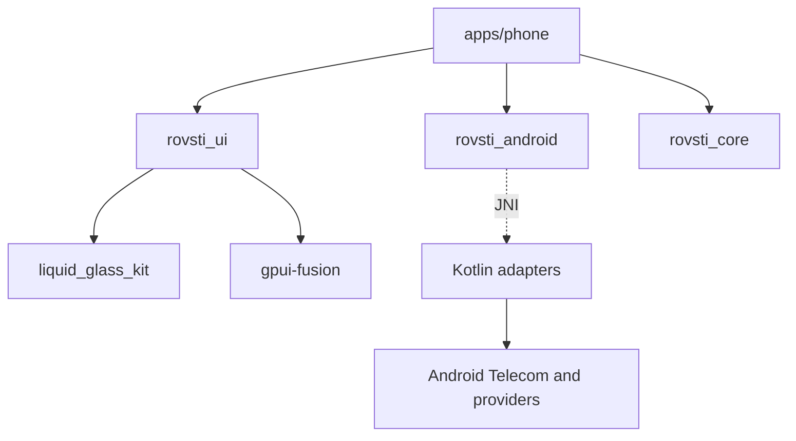
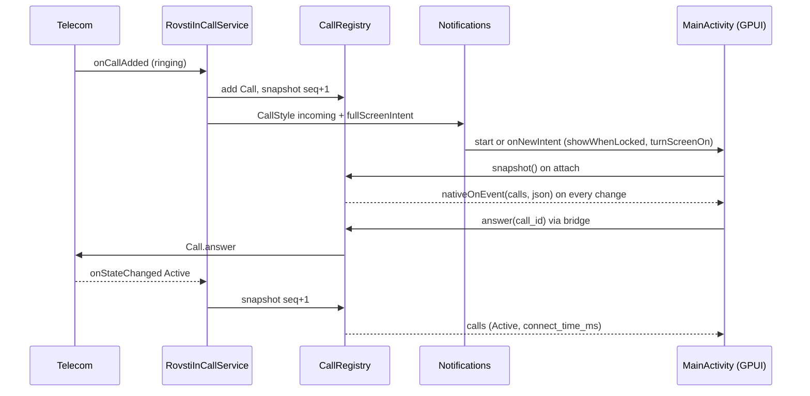

# Architecture Spine: Rovsti Phone

## Design Paradigm

**Android owns system state; Rust renders snapshots and issues commands.** Android system components (InCallService, notifications, providers, roles) are Kotlin adapters. The GPUI app is a pure renderer of immutable snapshots plus a command issuer. Domain logic is platform-free Rust. Layers map to directories:

| Layer | Where | Role |
| --- | --- | --- |
| Domain | `crates/rovsti_core` | Call model and reducer, call-log grouping, contact search, setup checklist logic, wire DTOs, frame stats. No I/O. |
| Ports | `crates/rovsti_android` | Generic JNI seam: command calls, event channel, provider pulls. `Error::Unsupported` on desktop. App-agnostic. |
| Presentation kit | `crates/rovsti_ui`, `crates/liquid_glass_kit` | Glass, springs, theme, accent, tab bar, perf hooks. |
| App | `apps/phone/src` | Views, view-models, `backend.rs` (the only caller of `rovsti_android`). |
| Android adapters | `crates/rovsti_android/kotlin` (shared), `apps/phone/platforms/android/app/src/main/kotlin/dev/rovsti/phone` (phone) | InCallService, CallRegistry, notifications, providers, activity glue. |

## Invariants & Rules



Allowed edges only: the arrows above. `rovsti_core` depends on nothing but serde and thiserror. `rovsti_android` depends on neither `rovsti_core` nor `rovsti_ui`. `rovsti_ui` never depends on `rovsti_android`. Kotlin never calls Rust except `nativeInit` and `nativeOnEvent`.

### AD-1 — Single GPUI activity is the in-call and incoming surface (resolves Q1)

- **Binds:** FR-19, FR-22, FR-24, NFR-2, NFR-6
- **Prevents:** a second `GpuiSession` (second wgpu `Application`) and two diverging call UIs.
- **Rule:** `MainActivity` (singleTop, extends `GpuiActivity`) is the only activity. A `setFullScreenIntent` on the incoming CallStyle notification targets it. `setShowWhenLocked(true)` and `setTurnScreenOn(true)` are called dynamically in `onCreate` and `onNewIntent` only while `CallRegistry` has a live call, and reset to false when the last call is removed. They are never set in the manifest. When a call surface ends, `moveTaskToBack(true)` keeps the GPUI session warm; `finish()` is not used for it. Evidence: `GpuiSession` is one `Application` per Activity, created at first Surface (hosting.md, `bridge.rs` `create`); additional windows are unsupported. A native Kotlin curtain over the `SurfaceView` (same activity, removed on first GPUI frame) is the pre-approved contingency only if spike S2 misses NFR-2. One Kotlin function `CallSurface.raise()`, owned by `RovstiInCallService`, is the only way the activity is brought up for a call: incoming (full-screen intent), after Answer (activity PendingIntent, not a broadcast trampoline, which Android 12+ blocks), and outgoing calls placed by any source (other apps, Bluetooth, Assistant). Back inside the app calls `moveTaskToBack(true)` (edit in the owned host `GpuiActivity.onBackPressed`), never `finish()`, so the session stays warm. Spike S2 must prove all five raise paths, locked and unlocked.

### AD-2 — Answerability never depends on GPUI

- **Binds:** FR-21, FR-23, FR-24, NFR-2, NFR-6, SM-2
- **Prevents:** a missed or unanswerable call because wgpu was still initialising or the view crashed.
- **Rule:** For every incoming Call, Kotlin posts one `Notification.CallStyle.forIncomingCall` (`Person` with the caller name; argument order is `(person, declineIntent, answerIntent)`; Decline goes to `CallActionReceiver` (registry-only, no activity start), Answer is an activity PendingIntent to `MainActivity` with extra `answer_call_id`) with the full-screen intent from AD-1. Ongoing calls post `CallStyle.forOngoingCall` with End. Notification actions call `CallRegistry` directly and never require Rust. The caller display name is resolved once in Kotlin (`ContactsQuery.lookup`) and carried in the snapshot as `display_name` (nullable); Rust never re-resolves it for calls. If `canUseFullScreenIntent()` is false, the heads-up notification with Answer/Decline is the committed fallback and the FR-5 Setup item is mandatory. Ringtone and vibration stay with Telecom (`IN_CALL_SERVICE_RINGING` is not set).

### AD-3 — Lock-screen call-only mode

- **Binds:** FR-22, FR-24, privacy
- **Prevents:** contacts, call log or tabs visible over the lock screen.
- **Rule:** Every snapshot carries `keyguard_locked`. When `keyguard_locked && calls non-empty`, the app renders only the Incoming or In-Call screen: no Tab Bar, no navigation, no Contact Sheet. `keyguard_locked` is derived in Kotlin from `KeyguardManager.isKeyguardLocked`, refreshed by `addKeyguardLockedStateListener` where available, else `ACTION_USER_PRESENT`/`ACTION_SCREEN_OFF` receivers registered only while a call exists, and on `onResume`; a missing value counts as locked. When locked with no calls remaining, the app renders a blank backdrop and calls `moveTaskToBack(true)` after the Call-ended hold; tabs never render over a locked keyguard.

### AD-4 — Kotlin `CallRegistry` owns call state; Rust attaches by snapshot (resolves Q3)

- **Binds:** FR-13..FR-20, FR-24, NFR-3, NFR-6
- **Prevents:** two owners of call state, lost state on GPUI restart, UI that disagrees with Telecom.
- **Rule:** `CallRegistry` (Kotlin singleton, process lifetime) is fed only by `RovstiInCallService` callbacks (`onCallAdded/Removed`, `Call.Callback`, audio state or `CallEndpoint`). It assigns a stable `call_id` (Int, never reused in a process). On GPUI attach, `main()` calls `calls::snapshot()` once, then consumes pushes. `rovsti_core::call::CallModel` stores the last snapshot; it never infers state from commands. A command is optimistic in the UI only for press feedback; displayed Mute, Route and Hold always come from the next snapshot (target under 500 ms). All registry mutation and snapshot building (incl. `seq`) happen on the main Looper; no lock is held across a binder call; `onUnbind` clears the registry and pushes an empty snapshot. Snapshot fields: `v, seq, now_ms, keyguard_locked, audio{muted,route,routes[]}, foreground_call_id, waiting_call_id, calls[]{id,state,number_raw,normalized,display_name?,connect_time_ms,can_hold,is_incoming,disconnect_cause?}`. Audio uses only `CallEndpoint` (minSdk 34). Kotlin maps `Call.STATE_*` to `dialing|ringing|active|holding|disconnected` and picks foreground/waiting ids; Rust validates, never re-selects. `answerReplacing` is a registry-owned pending operation that answers on the matching `onCallRemoved`, timeout 2 s.

### AD-5 — Event transport: whole-state JSON snapshots over one native method (resolves Q2)

- **Binds:** FR-13..FR-20, FR-29, NFR-3, NFR-7
- **Prevents:** per-event typed JNI signatures drifting between Kotlin and Rust, and delta/ordering bugs.
- **Rule:** Kotlin to Rust is exactly `RovstiBridge.nativeOnEvent(kind: String, json: String)` implemented in `rovsti_android::events`. It pushes into a process-static `Mutex<Option<UnboundedSender<RawEvent>>>`; it never touches GPUI types. `main()` installs a fresh channel on each session (replacing the old sink) and drains it in a GPUI foreground task. Kinds: `calls` (full `CallSnapshot`), `call_log_changed`, `contacts_changed`, `permissions_changed`. A snapshot carries a monotonic `seq`; the reducer ignores any `seq` lower than the one held. Events with no sink are dropped; attach re-pulls. Rust to Kotlin stays static methods taking String, Int, Boolean. Kotlin never calls `nativeOnEvent` directly: the only caller is `RovstiBridge.emit(kind, json)`, a no-op until `attachNative()` has run, catching `LinkageError`, so a registry mutation never throws out of a Telecom callback. Attach order in `main()`: install the new channel sink, then push `snapshot()` through it, then re-pull providers; the sink is cleared on session close. `permissions_changed` is emitted only from `MainActivity.onResume`.

### AD-6 — Commands are idempotent and id-addressed

- **Binds:** FR-14..FR-18, FR-20, FR-24, NFR-3
- **Prevents:** acting on the wrong or an already ended call.
- **Rule:** Every call command (`answer`, `reject`, `disconnect`, `hold(on)`, `mute(on)`, `route(name)`, `dtmf(char)`) takes `call_id` where relevant and returns Boolean. Unknown or stale ids are no-ops returning false. Waiting-call answer is one Kotlin method `answerReplacing(call_id)` that disconnects the active call first (FR-20), not two Rust calls.

### AD-7 — Elapsed time derives from wall clock, not ticks

- **Binds:** FR-13, NFR-5
- **Prevents:** timers that drift, restart, or force per-second JNI.
- **Rule:** The snapshot carries `connect_time_ms` (`Call.Details.getConnectTimeMillis`). `rovsti_core::call::format_elapsed(now_ms, connect_time_ms)` renders `m:ss` or `h:mm:ss`. The only per-second work during a call is repainting the timer text element.

### AD-8 — Native library is loaded by the activity, never by `Application`

- **Binds:** NFR-2, FR-1
- **Prevents:** loading the wgpu-sized `.so` on every InCallService cold bind.
- **Rule:** `RovstiPhoneApp.onCreate` initialises Kotlin-only pieces (channels, `CallRegistry`, `RovstiBridge.install(app)` without `System.loadLibrary`). `MainActivity.onCreate` calls `RovstiBridge.attachNative()` (which runs `nativeInit`) after `super.onCreate`, because `GpuiActivity` loads the library there. This replaces the load in the current `RovstiBridge.install`. `rovsti_android` must compile `BRIDGE.set` as idempotent across sessions.

### AD-9 — Provider data is pulled as JSON off the UI thread

- **Binds:** FR-26..FR-35, NFR-4
- **Prevents:** UI-thread provider queries and per-row JNI chatter.
- **Rule:** `providers::{call_log(limit), contacts(), favorites()}` return one JSON string per call and run on a GPUI background-executor thread (`with_bridge` attaches any thread). Kotlin keeps one `ContentObserver` each for `CallLog.Calls` and `ContactsContract`; they only emit `call_log_changed` / `contacts_changed`, debounced 300 ms. `setStarred(contact_id, bool)` is the only provider write besides `markMissedCallsRead()`. Rust builds the in-memory index once per payload and swaps it atomically (Arc swap) into the view; scroll position is preserved.

### AD-10 — Wire DTOs live in `rovsti_core::wire`, versioned

- **Binds:** FR-13, FR-26, FR-30, NFR-8
- **Prevents:** Kotlin/Rust field drift and untestable parsing.
- **Rule:** All JSON shapes are serde structs in `rovsti_core::wire` ignoring unknown fields (forward compatible) with a `v: 1` field, snake_case only, `#[serde(other)] Unknown` on every enum with a safe render (an unknown state never drops a snapshot), `connect_time_ms == 0` meaning not connected, `normalized` = digits with optional leading `+`. Provider pulls return `{v, ok, error?, data?}` and never throw; a `SecurityException` is `ok:false,error:"permission"`. Kotlin builds them with `org.json.JSONObject` (no new dependency). Every DTO has a golden-JSON unit test whose fixture in `crates/rovsti_core/tests/fixtures/` is also read by a Kotlin JVM unit test. `rovsti_android` moves strings only.

### AD-11 — Dial strings stay raw; `PhoneNumber` is for matching only

- **Binds:** FR-9..FR-12
- **Prevents:** rejecting `*#06#`, USSD, `,` `;`, or emergency numbers.
- **Rule:** `telecom::place_call(raw: &str)` passes the typed string to Kotlin unchanged. Only strings with no digit, `*` or `#` are rejected (shake). No Setup Item gates a call. Kotlin handles `STATE_SELECT_PHONE_ACCOUNT` by `phoneAccountSelected(default outgoing or first suggested, false)`.

### AD-12 — Dial intents are normalised in `MainActivity`

- **Binds:** FR-3
- **Prevents:** `ACTION_DIAL` being silently dropped (GPUI forwards only `ACTION_VIEW` with data).
- **Rule:** `MainActivity.onCreate/onNewIntent` rewrites `ACTION_DIAL` with a `tel:` URI into `ACTION_VIEW` before calling super; the app handles it in `Application::on_open_urls` by switching to Keypad with the number prefilled and placing no call. DIAL without data just opens Keypad.

### AD-13 — Per-app accent through `rovsti_ui::colors` (resolves UX-Q1)

- **Binds:** DESIGN accent, NFR-13
- **Prevents:** the kit's iOS-blue accent leaking in, and signature churn across components.
- **Rule:** `rovsti_ui::theme::set_accent(AccentPair { light, dark, glow })` is called once in `main()` of each app (`#08806E`, `#2DD4B4`, glow `#14C8A8` for Phone). `rovsti_ui::theme::colors(theme)` returns `Theme::colors()` with `accent` replaced. A workspace `clippy.toml` `disallowed-methods` forbids `Theme::colors` everywhere except `rovsti_ui::theme`. `liquid_glass_kit` is not modified.

### AD-14 — Pure logic placement and test floor

- **Binds:** NFR-8, FR-26, FR-31, FR-5..FR-8, FR-13
- **Prevents:** domain logic in views or Kotlin that cannot be unit-tested.
- **Rule:** In `rovsti_core`: `call` (CallModel, reducer, elapsed format, waiting-call selection), `call_log` (entry types, `group`, missed-badge count given last-seen), `search` (`ContactIndex`, Turkish-aware fold, digits match), `setup` (item state derivation from a readable-facts struct, Xiaomi confirmation and version-reset rule), `wire`, `perf` (FrameStats). Each has table-driven tests incl. the PRD's examples (ays/Ayşe, ozgur/Özgür, 5551112, consecutive-same-type grouping, `*#06#`). Views contain no branching on domain rules beyond rendering a core enum.

### AD-15 — Only `apps/phone/src/backend.rs` calls `rovsti_android`

- **Binds:** FR-38, NFR-7
- **Prevents:** Android calls scattered through views and desktop panics.
- **Rule:** `backend.rs` exposes a small `Backend` struct returning domain types. On `Error::Unsupported` it serves sample data (FR-38). Views take `Arc` snapshots from `Backend`; they never see `Result`.

### AD-16 — Threading

- **Binds:** NFR-3, NFR-4, NFR-6
- **Prevents:** re-entrancy into a borrowed GPUI `App` and ANRs.
- **Rule:** GPUI state mutates only on the main Looper, via `cx.spawn` tasks fed by the AD-5 channel. JNI event callbacks only enqueue. Blocking JNI (provider pulls) runs on `cx.background_executor()`. Call commands are non-blocking Kotlin methods that return after the Telecom call is issued. No Tokio runtime in Phone.

### AD-17 — Failure containment

- **Binds:** NFR-6, SM-2
- **Prevents:** a GPUI failure dropping or hiding a live call.
- **Rule:** If `GpuiSession.setOnError` fires or the view dies while a call exists, the ongoing-call notification (AD-2) remains and End works. `GpuiActivity.onCreate` installs `setOnError` privately, so after eject the owned host `GpuiActivity.kt` is edited to call an overridable `onGpuiError(error)`; `MainActivity` implements it by keeping the call notification and showing the native message only. `CallRegistry` has no dependency on GPUI classes.

### AD-18 — Manifest and permission contract

- **Binds:** FR-1, FR-5, FR-21..FR-25, NFR-1
- **Prevents:** role ineligibility and silent foreground-service crashes on Android 14+.
- **Rule:** Ejected manifest holds: `RovstiInCallService` (`BIND_INCALL_SERVICE`, `IN_CALL_SERVICE_UI=true`, `foregroundServiceType="phoneCall"`, exported), `MainActivity` filters (MAIN/LAUNCHER; `ACTION_DIAL` with and without `tel`; `VIEW` `tel` BROWSABLE), `CallActionReceiver` (not exported), `android:name=".RovstiPhoneApp"`. The service also declares the `android.telecom.InCallService` intent filter and never `IN_CALL_SERVICE_CAR_MODE_UI`. Final permission set: `CALL_PHONE, READ_CALL_LOG, WRITE_CALL_LOG, READ_CONTACTS, WRITE_CONTACTS, READ_PHONE_STATE, POST_NOTIFICATIONS, USE_FULL_SCREEN_INTENT, REQUEST_IGNORE_BATTERY_OPTIMIZATIONS, BLUETOOTH_CONNECT, FOREGROUND_SERVICE, FOREGROUND_SERVICE_PHONE_CALL, WAKE_LOCK`; `MANAGE_OWN_CALLS` and `BLUETOOTH_SCAN` are removed (ROLE_DIALER satisfies phoneCall FGS) and `gpuiforge.json` is updated to match. Notification lock-screen visibility is public for the caller name only (accepted trade-off); `allowBackup=false` stays. `INTERNET` must be absent from the merged manifest (checked by `scripts/check-apk.sh` with `aapt2 dump permissions`, run manually and listed in the final checks). `min_sdk` 34, `target_sdk` 36.

### AD-19 — Ejected host ownership and shared Kotlin source

- **Binds:** NFR-7, NFR-13, FR-39
- **Prevents:** copy-paste drift of `RovstiBridge.kt` between apps and edits to generated files being overwritten.
- **Rule:** Eject once (`gpuiforge platform eject android`) into `apps/phone/platforms/android` and commit it. Shared Kotlin stays only in `crates/rovsti_android/kotlin/dev/rovsti/bridge` and is included by a committed symlink `app/src/main/kotlin/dev/rovsti/bridge`. Phone Kotlin lives in `app/src/main/kotlin/dev/rovsti/phone`. `min_sdk` 34 is set through `variables.min_sdk` in `gpuiforge.json` and mirrored in the two literals of the ejected `app/build.gradle.kts`. Post-eject owned edits: manifest, `MainActivity`, `GpuiActivity` (Back, `onGpuiError`). The eject bakes absolute paths into `app/build.gradle.kts` (`workingDir`, `--manifest-path`); re-run a documented `scripts/fix-eject-paths.sh` if the repo moves.

### AD-20 — Build and signing pipeline

- **Binds:** FR-39, FR-40, SM-3
- **Prevents:** secrets in the repo or logs, and ABI/profile confusion.
- **Rule:** Debug loop: `gpuiforge run android --device <serial>` (arm64-v8a only, dev profile with the workspace `[profile.dev.package."*"] opt-level = 1`). Deliverable debug APK: `gpuiforge build android`; after the eject the artifact is `apps/phone/platforms/android/app/build/outputs/apk/debug/app-debug.apk` (the PRD's `target/gpuiforge/...` path is managed mode only; `gpuiforge info android` prints the truth and `check-apk.sh` reads it). Perf-realistic APK: `gpuiforge build android --abi arm64-v8a --rust-profile release` (debug-signed, debuggable). Signed release: `source ~/.config/rovsti/signing.env; gpuiforge build android --release` with a `signing` object in `gpuiforge.json` (`keystore` `~/.config/rovsti/rovsti-release.jks` absolute, `key-alias` `rovsti`, `store-password-env` `ANDROID_STORE_PASSWORD`, `key-password-env` `ANDROID_KEY_PASSWORD`). Passwords are never printed, logged, or passed as arguments; the keystore and `signing.env` are git-ignored (`*.jks`, `signing.env`). `ANDROID_NDK_HOME` must point at NDK 29.x. Adb path: `~/Android/Sdk/platform-tools`.

### AD-21 — Performance is engineered, never bought with visual cuts

- **Binds:** NFR-5, NFR-12, DESIGN Performance Budget
- **Prevents:** removing glass, refraction, signature moments or motion to hit a frame number.
- **Rule:** The full liquid-glass look and all 16 signature moments ship. A missed target stays a blocker and is never closed by a visual trade. Any shader, blur-pass or glass-merging change must keep `liquid_glass_kit` `shader_validates` and `glass_snapshot` pixel tests passing (pixel-equivalent output). Refractive-surface counts and "flat glass at rest" in DESIGN.md are advisory, not constraints. A missed target is fixed in code, in this order: (1) idle and re-render discipline: stateful springs request frames only while moving; `cached` views for static subtrees checked via `view_cache` hit rate; no `cx.notify()` per tick for non-visual state; (2) allocation discipline: no `String`/`Vec`/`SharedString` creation in per-frame paths (pre-intern, reuse buffers, fixed-size arrays for springs); (3) virtualised lists with fixed row heights (Contacts 58, Recents 58, header 28); photos decoded off-thread to 128 px in a 64-entry LRU; (4) glass pass cost: reuse the renderer's retained backdrop textures and scissored half-resolution blur (`wgpu_renderer::draw_backdrop_blurs` already limits copy and blur to bounds plus 2x radius), skip blur passes when `blur == 0`, merge adjacent same-spec glass (e.g. the 12 keys, the in-call control row) into one backdrop effect with an instance list, add a cheap shader path variant for non-pressed glass, and pre-compile pipelines at startup; (5) kit changes land in `liquid_glass_kit` with `shader_validates` and snapshot tests green. Visual changes exist only for the system reduced-motion setting and the kit's own `supports_backdrop_blur()` fallback. The 60 fps NFR is the floor; targets scale to the panel refresh rate.
- **Targets (measured, not assumed):** p95 frame work inside one display frame (16.6 / 11.1 / 8.3 ms at 60 / 90 / 120 Hz); CPU frame work under 4 ms; under 1% frames over budget and none over 2x during scripted tab switch, scroll, key press and call flows; cold start to first interactive frame under 1.2 s; idle 0 frames; warm incoming under 1.5 s, cold under 3 s.

### AD-22 — Profiling hooks are part of the product

- **Binds:** NFR-5, AD-21
- **Prevents:** performance claims without data.
- **Rule:** `rovsti_ui::perf` enables `Window::set_frame_diagnostics_enabled(true)` in debug and perf builds and each frame pushes `build_time`, `platform_draw_time`, `view_cache` into a fixed ring (`rovsti_core::perf::FrameStats`, no allocation). A scripted scenario list (S-tab, S-scroll-recents, S-keypad, S-incall, S-incoming) logs p50/p95/p99/max and over-budget counts to logcat tag `RovstiPerf` when leaving a scenario. Cross-check GPU/pacing with `adb shell dumpsys SurfaceFlinger --latency` on the `GpuiView` layer (a `SurfaceView` is not covered by HWUI `gfxinfo`). Thermal state (`App::on_thermal_state_change`) is logged with each report, not used to alter visuals. Perf mode is the Cargo feature `perf` on `rovsti_phone`, off in the signed release build. `platform_draw_time` can include surface waits and renderer diagnostics are unavailable on Android, so the 4 ms CPU figure is asserted from `build_time` only and GPU pacing from SurfaceFlinger latency.

## Consistency Conventions

| Concern | Convention |
| --- | --- |
| Naming | Kotlin package `dev.rovsti.bridge` (shared), `dev.rovsti.phone` (phone). JNI method names mirror Kotlin 1:1 (`isRoleHeld` -> `roles::is_held`). Event kinds are lower_snake. Rust modules singular nouns. |
| Data and formats | Ids: `call_id` Int, `contact_id` Long as `ContactId(i64)`. Times: epoch milliseconds Long. Numbers: raw dial string plus Kotlin-supplied `normalized` for matching. JSON via `org.json` and serde, field `v`. |
| State | One writer per entity: calls = `CallRegistry`; contacts/call log = Android providers; Starred = provider; Xiaomi confirmations, last tab, missed-seen time = JSON in `rovsti_ui::storage::data_dir` (no-backup), written by Rust only. |
| Errors | Bridge calls return `Result<_, rovsti_android::Error>`; `backend.rs` maps to domain states (`Unavailable`, `PermissionDenied`). No `unwrap` (workspace lint). |
| Lint enforcement | `cargo clippy --workspace --all-targets -- -D clippy::unwrap_used -D clippy::disallowed_methods` is added to the checks in CLAUDE.md. Existing `Theme::colors` callers (`rovsti_ui`, `apps/messages`, `apps/stops`) migrate to `rovsti_ui::theme::colors` in the same change that adds the ban; the only exception is `#[allow(clippy::disallowed_methods)]` on `rovsti_ui::theme`. |
| Logging | `log` crate; Kotlin tag `Rovsti`; perf tag `RovstiPerf`; never log numbers or names above debug level; never log credentials. |
| Tests | Core: `cargo test -p rovsti_core`. Kotlin pure helpers: JVM unit tests. Device: manual checklist per milestone; emulator `adb emu gsm call` for flows. |

## Stack

| Name | Version |
| --- | --- |
| Rust | stable, rust-version 1.94, edition 2024 |
| gpui-fusion (gpui, gpui_android, gpui_icons, gpui_wgpu, gpui_effects) | rev d6c84124 |
| liquid_glass_kit, rovsti_* | workspace path |
| jni crate | 0.21.1 (pinned; 0.22 exists, revisit on a gpui-fusion bump) |
| serde, serde_json, thiserror | 1, 1, 2 |
| GPUiForge | 0.1.0 (commit b79779f) |
| Android Gradle Plugin / Gradle | 9.2.1 / 9.4.1 (bundled wrapper) |
| androidx.core (host) | 1.18.0 |
| compileSdk / targetSdk / minSdk | 36.1 / 36 / 34 |
| Android NDK | 29.0.14206865 |
| JDK | 25 installed (17+ required) |
| ABIs | arm64-v8a (device), x86_64 (emulator) |

## Structural Seed



```text
apps/phone/
  gpuiforge.json            # + min_sdk 34, signing object (release)
  src/main.rs               # app shell, accent, on_open_urls, event drain
  src/backend.rs            # only caller of rovsti_android; sample data on desktop
  src/{keypad,incall,incoming,recents,contacts,favorites,setup}.rs
  platforms/android/        # ejected, owned, committed
    app/src/main/AndroidManifest.xml
    app/src/main/kotlin/dev/rovsti/bridge -> ../../../../../../../../crates/rovsti_android/kotlin/dev/rovsti/bridge  (symlink)
    app/src/main/kotlin/dev/rovsti/phone/
      RovstiPhoneApp.kt  MainActivity.kt  RovstiInCallService.kt  CallRegistry.kt
      CallNotifications.kt  CallActionReceiver.kt  ProximityController.kt
      CallLogQuery.kt  ContactsQuery.kt  SnapshotJson.kt
crates/rovsti_core/src/{call,call_log,search,setup,wire,perf}.rs
crates/rovsti_android/src/{events,calls,providers,permissions}.rs
crates/rovsti_ui/src/{theme,perf}.rs
scripts/{check-apk.sh,fix-eject-paths.sh}
```

Kotlin components: `RovstiPhoneApp` (Application), `MainActivity`, `RovstiInCallService`, `CallRegistry`, `CallNotifications` (channels `incoming` importance high, `ongoing` low), `CallActionReceiver`, `ProximityController` (`PROXIMITY_SCREEN_OFF_WAKE_LOCK` while earpiece route and Active), `CallLogQuery` / `ContactsQuery` (+ observers), `RovstiBridge` (shared: roles, permissions, Xiaomi, events). Foreground service: `RovstiInCallService.startForeground(ONGOING_ID, n, FOREGROUND_SERVICE_TYPE_PHONE_CALL)` on first live call, stopped when the last is removed.

### Build order and de-risking

1. **S1 Eject plus hello APK** (if the `Java_*` symbol is missing from the `.so`, force a reference from `backend.rs` or use `RegisterNatives`). Eject, apply AD-18/19 edits, add `nativeOnEvent` stub, build debug APK, install, confirm GPUI renders, `nm -D librovsti_phone.so` shows `Java_dev_rovsti_bridge_RovstiBridge_nativeInit` (dependency `no_mangle` export), merged manifest has no `INTERNET`, role picker lists the app.
2. **S2 Incoming spike.** InCallService + CallRegistry + notification + fullScreenIntent + dynamic showWhenLocked on the emulator (`adb emu gsm call`) and the phone; log timestamps `onCallAdded` -> first GPUI frame warm and cold; verify `startForeground` phoneCall, HyperOS lock-screen behaviour. Decide curtain yes/no.
3. **Core logic** (`call`, `call_log`, `search`, `setup`, `wire`, `perf`) with tests; no device needed.
4. **Seam**: events, snapshot, commands, providers; desktop `Unsupported` parity.
5. **P0 screens** (Keypad->call, In-Call, Incoming, Recents), then P1 (Setup, Contacts, Favorites, hold, waiting call), then P2.
6. **Perf pass** with AD-22 scenarios before polish sign-off; **signed release** build last.

## Capability -> Architecture Map

| Capability / Area | Lives in | Governed by |
| --- | --- | --- |
| FR-1..FR-4 role, preview | manifest, `RovstiBridge`, `backend.rs` | AD-18, AD-19, AD-12 |
| FR-5..FR-8 setup | `rovsti_core::setup`, `rovsti_android::permissions/xiaomi`, `storage` | AD-14, AD-15 |
| FR-9..FR-12 keypad, outgoing | `apps/phone/src/keypad.rs`, `telecom::place_call`, `search` | AD-11, AD-14 |
| FR-13..FR-20 in-call | `rovsti_core::call`, `incall.rs`, `CallRegistry` | AD-4..AD-7 |
| FR-21..FR-25 incoming, missed | `RovstiInCallService`, `CallNotifications`, `incoming.rs` | AD-1..AD-3 |
| FR-26..FR-35 lists | `call_log`, `search`, `providers`, virtualised lists | AD-9, AD-21 |
| FR-36..FR-38 shell, theme | `rovsti_ui`, `backend.rs` sample data | AD-13, AD-15 |
| FR-39, FR-40 build | `gpuiforge.json`, scripts | AD-19, AD-20 |
| NFR-5, NFR-12 | `rovsti_ui::perf`, kit | AD-21, AD-22 |
| NFR-1 | manifest check | AD-18 |

## Deferred

- Curtain / native incoming fallback implementation: only if S2 fails NFR-2.
- Dual-SIM picker, blocklist, swap/merge/conference, route picker, T9: PRD out of scope.
- Missed-call own notification (PRD Q4): revisit after first week on device. Xiaomi confirmation reset ships as the FR-8 default in `rovsti_core::setup`; only changing the policy (PRD Q5) is deferred.
- Missed badge: `rovsti_core::call_log::missed_badge(entries, last_seen_ms)` computes it; Rust stores `last_seen_ms`; `markMissedCallsRead()` is called when Recents is viewed.
- Promoting contacts/call-log Kotlin to the shared bridge for Messages: when Messages needs it (NFR-13 stays satisfied by `providers` being generic Rust).
- Glass pass merging internals (instancing API shape in `liquid_glass_kit`): decided by profiling in the perf pass; AD-21 fixes the order of measures, not the final API.
- Release R8/minify: off until a release candidate; `proguard-rovsti.pro` already keeps the bridge.
